# AutoFix

[](https://github.com/zhanghl-learner/docker-ollama-autofix/actions/workflows/ci.yml)

AutoFix is a local-first command-line tool that detects a project's build system, reproduces failures, asks a local Ollama model for bounded line-level edits, validates them in isolation, and accepts only repairs that pass the real build or test command.

## Positioning and maturity

AutoFix is a safety-first code-repair engineering prototype and evaluation harness. It is intended for reproducible build or test failures in small and medium repositories where a developer can review the resulting diff. It is not positioned as a general autonomous programmer or as an unattended production service.

The current evidence base includes an automated Windows test suite, real local repair loops across Python, Node.js, Go, C++, and Java, Docker-isolated Python verification, and two repeatable multi-file benchmark cases. The released 0.19.0 baseline passed 162 Windows tests; the Linux Docker self-host passed 161 and skipped the one Windows-only `CreateProcess` integration test. In the current benchmark, `qwen3:0.6b` completed neither complex case, while `qwen2.5-coder:7b` completed both under the 0.19.0 retry protocol. These results demonstrate the repair pipeline and its ability to expose model differences; they do not yet establish broad success on arbitrary repositories.

The next development phase is **safe real-repository integration and evaluation at scale**. Human review remains part of the intended workflow. See the [development roadmap](docs/ROADMAP_ZH.md) for milestones, acceptance criteria, and release preparation.

## Documentation

- [中文使用手册](docs/USAGE_ZH.md) — installation, one-time setup, daily workflow, offline deployment, recovery, and troubleshooting.
- [实现原理与代码架构](docs/ARCHITECTURE_ZH.md) — architecture, repair state machine, model protocol, validation, isolation, audit, rollback, tests, and extension points.
- [多语言闭环验证报告](docs/MULTILANG_VALIDATION_ZH.md) — real Python, Node.js, Go, C++, and Java repair results plus missing-toolchain gates.
- [复杂项目评测指南](docs/EVALUATION_ZH.md) — benchmark contracts, isolated model scoring, metrics, and fixture authoring.
- [开发路线图与发布准备](docs/ROADMAP_ZH.md) — product positioning, maturity boundaries, milestone priorities, and definition of done.
- [学习导读](docs/LEARNING_GUIDE_ZH.md) — a progressive mental model and study path for new maintainers.
- [核心代码导读](docs/CORE_CODE_WALKTHROUGH_ZH.md) — the main call paths, data contracts, and module responsibilities.
- [动手实验](docs/HANDS_ON_ZH.md) — reproducible exercises for preview, plan, patch, commit, and safety rejection.
- [CI JSON 契约](docs/CI_CONTRACT_ZH.md) — stable statuses, reserved exit codes, JSON schema, and GitHub Actions usage.
- [Changelog](CHANGELOG.md) — versioned feature and verification summary.

## Architecture at a glance

```mermaid
flowchart LR
    PROJECT[Project + autofix.yml] --> GIT{Git workspace policy}
    GIT -->|clean committed repo| WORKTREE[Detached temporary worktree]
    GIT -->|dirty or unborn repo| STOPGIT[Stop before build/model]
    GIT -->|non-Git project| COPY[Disposable project copy]
    WORKTREE --> DETECT[Detect and select BuildStep matrix]
    COPY --> DETECT
    CONTRACT[autofix-eval.yml] --> EVAL[Reproducible evaluation]
    EVAL --> BUILD
    EVAL --> MODEL
    DETECT --> BUILD[Local or constrained Docker build]
    BUILD -->|failure| DIAG{High-confidence environment failure?}
    DIAG -->|yes| STOP[Audit report, no model call]
    DIAG -->|no| MODEL[Bounded context to local Ollama]
    MODEL --> PATCH[Exact line-edit validation]
    PATCH --> SANDBOX[Verify in worktree or disposable copy]
    SANDBOX -->|pass| PLAN[Git provenance + policy bound plan v4]
    PLAN --> APPLY[Deterministic apply-plan]
    APPLY --> ARTIFACT[Standalone patch + SHA-256]
    ARTIFACT --> AUDIT[Report, history, rollback, undo]
    ARTIFACT -->|explicit --commit only| COMMIT[Exact-file local commit]
    SANDBOX -->|fail| MODEL
```



The model proposes edits but never decides acceptance and never writes directly to the original project. The validator, the bound build matrix, and real process exit codes form the acceptance gate. See the [full architecture and sequence diagrams](docs/ARCHITECTURE_ZH.md).

## Current capabilities

- `autofix doctor` checks Python, Git, Docker/Podman, Ollama, and the local Ollama API.
- `autofix configure` saves user-level runtime defaults that every new project inherits automatically.
- On Windows, Docker Desktop and Ollama are also discovered from their standard per-user and Program Files locations when a newly opened terminal has not inherited their PATH entries.
- `autofix init [PATH]` detects a project and creates `autofix.yml` without overwriting an existing configuration.
- Single-file Python programs with top-level runtime logic are executed as their build check, so runtime errors such as missing imports reach the repair model; passive library modules still use `compileall`.
- Confident environment failures such as declared-but-missing Python/Node dependencies, missing compilers/linkers/build tools, incompatible JDK releases, unavailable Docker images/daemon, and offline Cargo cache misses are separated from code failures; AutoFix records the diagnosis without asking the model to edit source.
- `autofix inspect [PATH]` detects Python, CMake, Maven, Gradle, npm/pnpm/yarn, Rust, and Go projects; polyglot repositories can select a detected system with `--build-system` or `build.system`.
- `autofix git-status [PATH]` reports the repository root, branch or detached HEAD, baseline commit, tracked/untracked paths, and direct-apply policy without changing Git. Add `--require-clean` for a CI/preflight cleanliness gate.
- `autofix run [PATH]` executes the selected build plan without a shell and saves a JSON report under `.autofix/runs/`.
- `autofix ci-check [PATH]` performs non-interactive verification with a versioned JSON envelope and reserved exit codes for pass, verification failure, environment failure, policy rejection, configuration failure, and internal failure.
- Ordered build matrices can be declared with `build.commands` or repeated `--step`; execution stops at the first failing step and repair is accepted only when every step passes.
- `autofix repair [PATH]` requires a clean committed Git baseline, then runs baseline reproduction, model edits, and verification in a detached temporary worktree. Dirty/unborn repositories stop before build or Ollama; non-Git projects retain disposable-copy isolation.
- Failed verified candidates are audited with their exact diff and test regressions, then discarded before the next attempt. Retries start from the same clean baseline, receive cumulative evidence about persistent failures and branch reachability, reject duplicate/cyclic states, and require the actual edit to implement its structured causal diagnosis.
- Repair context ranks files named by build output, local Python/JavaScript/TypeScript/C/C++ imports reachable from those files, and bounded fallback sources. Terminal progress and JSON evidence state why every file was selected; this ranking never expands the project boundary or editable-path policy.
- `autofix apply-plan PLAN --project PATH` applies the exact reviewed proposal without a second model request. Plan v4 binds the v3 execution policy plus repository fingerprint, baseline commit, project subpath, original file hashes, and final diff SHA-256.
- Every successful repair writes a standalone unified patch and its byte-level SHA-256. Use `--patch-output FILE` for a CI-friendly location; existing files are never overwritten.
- `repair --apply --commit` and `apply-plan --commit` can create one local commit containing only the verified files. AutoFix rechecks HEAD, repository identity, file bytes, and the exact Git change set, preserves hooks, and never pushes or merges.
- `autofix history [PATH]` lists timestamped repair audit reports, including rejected proposals, diffs, verification, and rollback outcomes.
- `autofix evaluate [PATH]` validates an intentionally failing benchmark, including its expected exit code, failing step, and output signature; `--repair` runs Ollama only after that preflight matches, in an isolated copy, and scores changed-file scope against `autofix-eval.yml`.
- `autofix evaluate-suite [PATH]` recursively discovers evaluation manifests and runs deterministic baselines as one suite; add `--repair --model MODEL` to score isolated model repairs. Human mode shows a live Ollama/verification spinner, proposal diagnosis and edit locations, then prints every verified unified diff. It retains invalid and failed cases and writes versioned JSON/Markdown evidence.
- `autofix rollback REPORT --project PATH` reverses a recorded repair and first backs up the replaced files.
- `autofix undo [PATH]` automatically reverses the latest successful repair that has not already been undone.
- `--docker` runs build verification in a constrained container against a disposable project copy.
- `autofix offline-check` verifies the build plan, offline policy, dependencies, Docker image, and Ollama model before disconnecting the network.
- `autofix bundle` exports, verifies, and restores the Docker image and Ollama model needed on an offline machine.
- `--command` overrides automatic detection, `--dry-run` previews commands, and `--json` provides machine-readable output.

AutoFix selects the first detected build system by default and reports every match. Polyglot repositories can select a different match explicitly; execution is still based on one selected build system per invocation.

The Python source uses English module and public-API docstrings throughout. Comments focus on security invariants, non-obvious algorithms, and design rationale rather than restating individual statements; the user-facing guides remain available in Chinese.

## Install for development

```powershell
python -m venv .venv
.\.venv\Scripts\Activate.ps1
python -m pip install -e ".[dev]"
```

On macOS or Linux, activate the environment with `source .venv/bin/activate`.

## Use

```powershell
autofix --version
autofix doctor
autofix configure --model qwen3:0.6b --docker-image autofix-python:3.11 --offline
autofix init C:\path\to\project --model qwen3:0.6b
autofix inspect .
autofix git-status . --require-clean
autofix run . --dry-run
autofix run .
autofix evaluate examples\complex-validation\python-order-service
autofix evaluate-suite examples\complex-validation
autofix evaluate-suite examples\complex-validation --repair --model qwen2.5-coder:7b
autofix evaluate examples\complex-validation\python-order-service --repair
autofix repair . --model qwen3:0.6b
autofix history .
autofix undo .
autofix rollback .autofix\repairs\REPORT.json --project .
```

Repair is verified-preview-only by default. Model proposals are applied to a temporary project copy and the real build/test command must pass before a plan is created. The original project remains unchanged. Explicitly opt in to modifying files and rebuilding:

```powershell
autofix repair C:\path\to\project --model qwen3:0.6b --apply
```

For deterministic approval, preview first and use the emitted plan path:

```powershell
autofix repair C:\path\to\project --docker --max-attempts 3
autofix apply-plan C:\path\to\project\.autofix\plans\PLAN.json --project C:\path\to\project
```

To retain a portable patch or explicitly create a local commit after the same verification gate:

```powershell
autofix apply-plan .autofix\plans\PLAN.json --project . --patch-output artifacts\repair.patch
autofix apply-plan .autofix\plans\PLAN.json --project . --commit --commit-message "fix: apply verified AutoFix repair"
```

The patch is plain unified diff and can be checked with `git apply --check`. The optional commit records an `AutoFix-Diff-SHA256` trailer. Commit hooks still run; if a hook or Git identity check fails, the verified files remain applied for inspection and no push or merge is attempted.

Plans contain only the consolidated original-to-verified-final result, the SHA-256 of every original file, and the verification policy that passed preview. Plan v4 automatically reuses its local/Docker runner, timeout, commands, image, network policy, and resource limits, so `--docker` does not need to be repeated. For Git projects it also rejects a different repository, HEAD, or project subpath; every plan verifies a canonical final diff SHA-256. Failed intermediate attempts are not included. Keep `.autofix/plans` private because it can contain project source code.

Only existing UTF-8 source/configuration files inside the project may be changed. Production sources are presented before protected test files so small models focus on implementation while using assertions as the behavioral contract. The repair model submits line-level splice operations containing a 1-based start line, deletion count, exact expected old text, and replacement text. AutoFix rejects stale line coordinates, mismatched old text, overlapping edits, absolute paths, `..` traversal, unsupported file types, oversized proposals, and changes to more than five files. Content outside the declared edit ranges is assembled from the original file rather than regenerated by the model. A mislabeled code block may be aligned against its exact source anchor and reduced to its smallest line diff; ambiguous blocks are rejected. AutoFix also rejects results that remove more than half of a substantial file or remove top-level Python classes/functions. Legacy import-only full-file proposals are safely merged into the original file. If verification fails, AutoFix restores every modified file unless `--keep-failed` is explicitly supplied.

If an earlier repair was accepted but changed the wrong code, restore it from its audit report. Rollback verifies that every current file still matches the recorded patch and saves the replaced version under `.autofix/rollback-backups/` before writing:

```powershell
autofix history .
autofix rollback .autofix\repairs\REPORT.json --project .
```

For the common case, `autofix undo .` selects the latest successful applied repair automatically. Every successful undo writes a receipt under `.autofix/rollbacks/`; `history` marks that repair as `undone`, and subsequent undo operations skip it.

Test files are protected by default. Rejected no-op, test-file, duplicate, cyclic, or otherwise unsafe proposals consume an attempt and are returned to the model as retry feedback. A statically valid edit that fails verification is restored before the next attempt; its diff, model diagnosis, build output, and newly failing tests remain in the audit trail. Use `--allow-test-changes` only when the test itself is known to be incorrect.

Applied repairs use `--isolate` by default: model edits and failed verification attempts occur in a temporary project copy, and only a successful final state is written back. AutoFix also refuses the commit if an original file changed concurrently. Use `--no-isolate` only for projects whose build cannot run from a copied workspace.

AutoFix distinguishes a missing import statement from a missing installed dependency. `NameError: name 'torch' is not defined` remains eligible for a localized code repair, while `ModuleNotFoundError: No module named 'torch'` stops before the model is called. Install the package in the local environment or use a project Docker image that contains it, then rerun the repair.

## Docker isolation

The Docker executor copies the project into a temporary workspace, so build tools cannot write into the original checkout. It also uses a read-only container root filesystem, drops Linux capabilities, enables `no-new-privileges`, limits CPU, memory and process count, and disables networking by default.

Images must already exist locally because AutoFix passes `--pull never`:

```powershell
docker pull python:3.11-slim
docker build --file docker/python.Dockerfile --tag autofix-python:3.11 .
autofix run . --docker
autofix repair . --docker --model qwen3:0.6b --apply
```

Use a project-specific image when dependencies such as pytest are not present in the default language image:

```powershell
autofix run . --docker --docker-image my-project-builder:latest
```

Container networking is available only through the explicit `--allow-network` option. It should be used only when the build genuinely needs remote dependencies.

Run a custom build command:

```powershell
autofix run C:\path\to\project --command "python -m pytest"
```

Run an ordered validation matrix without changing configuration:

```powershell
autofix run . `
  --step "python -m compileall -q src tests" `
  --step "python -m pytest" `
  --step "python -m build"
```

`--command` and `--step` are mutually exclusive. Matrix steps run without a shell, in declaration order, and stop immediately after the first failure.

Machine-readable output is available on all inspection commands:

```powershell
autofix doctor --json
autofix offline-check .
autofix inspect . --json
autofix git-status . --json
autofix run . --json
```

Project defaults can be stored in `autofix.yml`. Explicit CLI options always take precedence:

```yaml
version: 1
build:
  system: python
  commands:
    - python -m compileall -q src tests
    - python -m pytest
runtime:
  docker_image: autofix-python:3.11
  ollama_model: qwen3:0.6b
  offline: true
  dependencies_bundled: true
```

For defaults shared by new projects, configure AutoFix once:

```powershell
autofix configure --model qwen3:0.6b --docker-image autofix-python:3.11 --offline
```

The settings are stored in `%USERPROFILE%\.autofix\settings.yml`. A new project without `autofix.yml` inherits these runtime values while its build command is detected from its own files. Precedence is: command-line option, project configuration, user configuration, automatic detection. Set `AUTOFIX_HOME` only when a separate settings location is required.

## Offline runtime bundle

After `autofix offline-check .` passes, create a self-contained runtime bundle. The output directory must not already exist:

```powershell
autofix bundle create dist\autofix-runtime --project .
autofix bundle verify dist\autofix-runtime
```

Copy that directory to a 64-bit Windows machine. After installing Docker Desktop, Ollama, and Python 3.11, run the bootstrap script; AutoFix itself and all Python dependencies are installed from the bundled wheelhouse without contacting a package index:

```powershell
Set-ExecutionPolicy -Scope Process Bypass
& D:\transfer\autofix-runtime\install.ps1
```

The bundle contains an offline Python wheelhouse and `install.ps1`, `docker/image.tar`, the Ollama GGUF model and portable `Modelfile`, a copy of `autofix.yml`, and `bundle-manifest.json`. Installation verifies every payload SHA-256 before installing AutoFix, invoking `docker image load`, and invoking `ollama create`. Treat the bundle as sensitive and confirm that the model license permits transfer to the target machine.

## Safety boundary

AutoFix runs only a known detected command or an explicit command supplied by the user. Repairs generate a diff, reject paths outside the project, use a bounded number of attempts, and are accepted only after the real build or tests pass. A Git repair never stashes or cleans user work: dirty and unborn repositories are rejected, while clean committed repositories use a detached temporary worktree. Failed applied repairs are rolled back unless `--keep-failed` is supplied.

A passing build proves only the configured gate. It does not prove business correctness, security, or production readiness. Use a clean Git worktree, inspect the diff, and run independent checks before committing. Docker restrictions reduce risk but are not a strong sandbox for hostile repositories or build scripts.

Evaluation is deliberately non-mutating. A baseline case passes only when its declared commands reproduce the expected failure signature; an unrelated import, toolchain, or environment failure is invalid. Repair evaluation additionally requires the final build to pass, every required file to be touched, and no file outside `allowed_change_paths` to change. Single-case reports are saved under `.autofix/evaluations/`; suite evidence is atomically published under `.autofix/evaluation-suites/`. Use `--no-save` for ephemeral checks.

## Roadmap

The v1 evaluation contract is established by the Python and Node.js multi-file boundary-condition fixtures. Git worktree isolation, CI result contracts, baseline suite aggregation, and isolated model-repair suite scoring are implemented. The next slices add model identity metadata and broader Go/Rust/Java/C++ cases. The detailed order and exit criteria are maintained in [docs/ROADMAP_ZH.md](docs/ROADMAP_ZH.md).

## License

AutoFix is released under the [MIT License](LICENSE).
