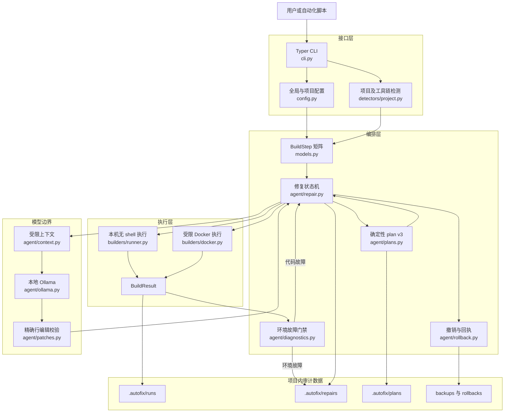
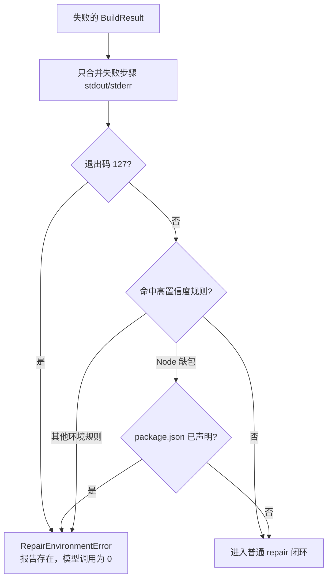
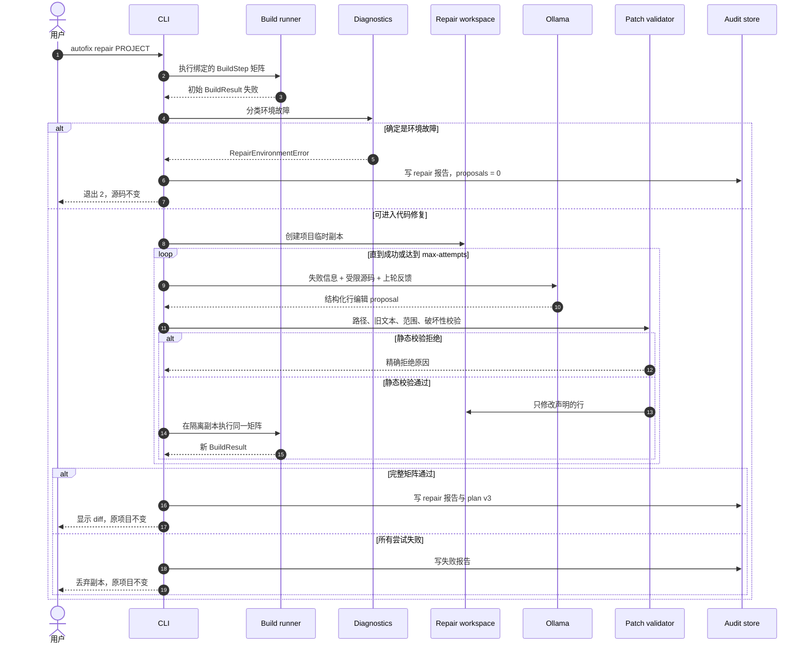
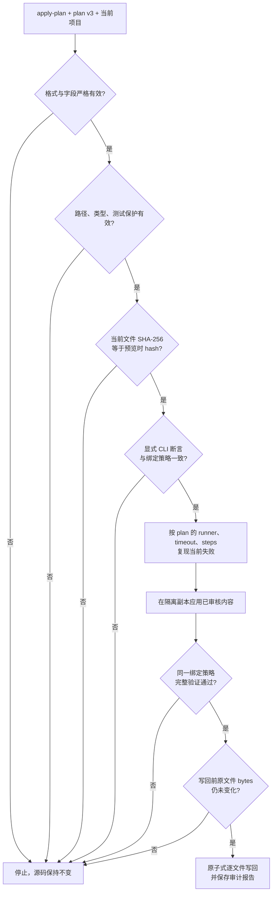
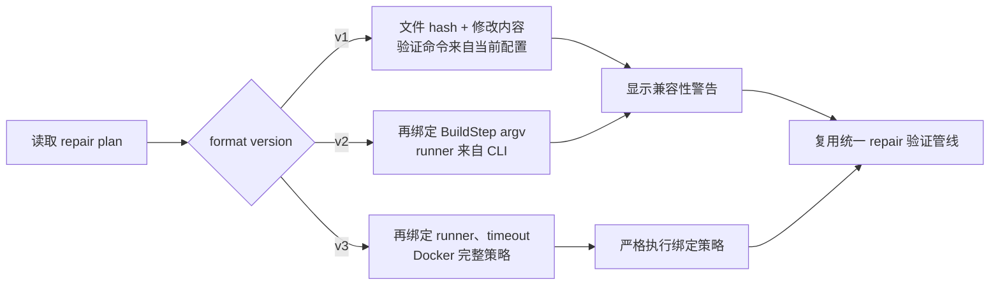

# AutoFix 实现原理与代码架构

本文面向维护者和希望审计 AutoFix 行为的使用者，对应版本 0.15.0。它说明系统为什么这样设计、一次修复如何流转、哪些代码执行关键安全检查，以及如何扩展。

## 1. 目标与非目标

AutoFix 的目标是完成一个本地闭环：

1. 识别项目和可验证命令；
2. 在本机或受限 Docker 中复现失败；
3. 区分代码问题与明确的环境问题；
4. 只向本地 Ollama发送受限上下文；
5. 接收具体到文件、行号和旧/新代码的结构化编辑；
6. 对提议做静态安全校验；
7. 在隔离副本执行真实构建；
8. 仅保留验证通过的结果，并提供审计、确定性应用与撤销。

它目前不是：

- 通用自主开发代理；
- 依赖安装器；
- 任意文件创建、删除或重构工具；
- Git 的替代品；
- 对恶意项目构建脚本的完整沙箱；
- 多服务、多仓库或交互式构建编排器。

## 2. 总体架构



读图时应区分三条边界：配置和检测只决定候选验证计划；模型只能产生候选编辑；最终接受与否只由确定性校验器和真实构建结果决定。Ollama 不直接写项目文件，也不能绕过 `BuildStep` 矩阵。

### 2.1 核心数据流

| 输入 | 中间对象 | 输出 |
| --- | --- | --- |
| `autofix.yml`、CLI 参数、项目标记 | `ProjectInspection`、`AutoFixConfig` | 有序 `BuildStep` |
| 失败的 `BuildResult`、受限源码 | Ollama JSON、`RepairProposal` | 候选 `FileEdit` |
| 原文件、候选编辑 | `ValidatedChange` | 精确 diff 或拒绝原因 |
| 验证后的修改、执行策略 | `RepairPlan` v3 | 可审核、可确定性应用的 JSON |
| 成功 repair 报告、当前文件 | 反向 diff 与 hash 检查 | rollback 备份和回执 |

## 3. 代码目录与职责

```text
src/autofix/
├── cli.py                  # 命令、参数、用户输出和退出码
├── config.py               # 用户级/项目级 YAML 合并与校验
├── models.py               # BuildStep、ProjectMatch、ProjectInspection
├── detectors/project.py    # 构建系统与 Python 入口检测
├── builders/
│   ├── runner.py           # 无 shell 的本机构建、超时、运行报告
│   └── docker.py           # Docker 命令、隔离副本、资源限制
├── agent/
│   ├── context.py          # 源码选择、截断、失败格式化
│   ├── diagnostics.py      # 明确环境错误分类
│   ├── ollama.py           # 提示词、JSON Schema、HTTP 客户端
│   ├── patches.py          # 行编辑归一化、验证、应用与恢复
│   ├── repair.py           # 多轮修复状态机、隔离验证、提交、报告
│   ├── plans.py            # 预览 plan、原文件 hash、重新校验
│   ├── rollback.py         # 反向 diff、备份、回执和 undo 选择
│   └── textio.py           # 保留 LF/CRLF 的精确 UTF-8 源码读写
└── runtime/
    ├── doctor.py           # 本机工具和 Ollama 服务诊断
    ├── offline.py          # 离线就绪检查
    ├── bundle.py           # 离线导出、manifest、校验和导入
    └── tools.py            # PATH 与 Windows 标准安装位置发现
```

`tests/` 按上述模块覆盖检测、配置、执行、Docker 参数、模型协议、补丁安全、隔离提交、plan、rollback、离线检查和 bundle。

## 4. 配置系统

`config.py` 定义不可变的 `AutoFixConfig`：

```python
@dataclass(frozen=True)
class AutoFixConfig:
    path: Path
    version: int
    command: str | None
    commands: tuple[str, ...]
    build_system: str | None
    docker_image: str | None
    ollama_model: str | None
    offline: bool
    dependencies_bundled: bool
```

`load_config()` 分别读取用户级配置与项目配置，对 `build`、`runtime` 两个 mapping 做字段合并。项目字段覆盖用户字段；CLI 层再用显式参数覆盖合并结果。`build.command` 与 `build.commands` 是互斥字段：项目声明其中一个时，会明确替换用户级配置中的另一种形式，而不是合并成歧义配置。YAML 必须是 mapping，当前只接受版本 1，字符串不得为空，命令矩阵必须是非空字符串列表，布尔字段必须真的是布尔值。

用户路径默认是 `Path.home() / ".autofix" / "settings.yml"`，也可通过 `AUTOFIX_HOME` 改变根目录。项目文件优先查找 `autofix.yml`，其次 `.autofix.yml`。

## 5. 项目检测与命令选择

`detectors/project.py` 为每种构建系统返回 `ProjectMatch`，其中包括语言、构建系统、标记文件和一个或多个 `BuildStep`。检测优先级是：Python、CMake、Maven、Gradle、Node、Rust、Go；`ProjectInspection.selected` 默认使用第一个匹配。

`ProjectInspection.select()` 可以把指定的已检测系统稳定地移动到 matches 首位，其他匹配顺序不变。CLI 按 `--build-system`、项目 `build.system`、默认检测顺序选择，拼写错误或未检测到的系统会列出实际候选并在执行前停止。这样 Docker 默认镜像、自动命令和用户输出都基于同一个选中对象，而不是各模块独立判断。

Python 比简单的“看到 `.py` 就 compileall”多一步运行性分析：

- 有测试标记时选择 pytest；
- 否则用 AST 检查根目录脚本是否存在顶层运行逻辑；
- 优先 `main.py`、`app.py`、`run.py`；
- 只有一个可运行脚本时直接执行它；
- 否则才退回 `compileall`。

这解决了语法检查通过、运行时错误却永远无法进入 repair 的问题。CLI 还会识别旧版本生成的 `python -m compileall -q .` 配置；若现在能够可靠识别入口，会在当前运行中升级为入口命令并打印提示，但不会偷偷重写配置文件。

自定义命令由 `shlex` 解析成 argv。执行器不启用 shell，因此管道、重定向、环境变量展开和命令连接符不会自动解释。这是明确的安全边界；复杂流程应放进项目自身受审查的脚本，再把脚本作为单个命令执行。

### 5.1 有序构建矩阵

`build.commands` 和可重复的 `--step` 最终都转换成 `tuple[BuildStep, ...]`，因此复用检测器原本就支持的多步骤执行模型。优先级是：CLI `--step`、CLI `--command`、项目/用户 `build.commands`、项目/用户 `build.command`、检测结果。`--step` 和 `--command` 同时出现会在启动子进程前被拒绝。

矩阵不是 shell 命令链：每个元素独立解析和执行，前一步成功才进入下一步。报告保留每个已执行步骤的 argv、输出、退出码与耗时；未执行步骤不会伪造结果。repair 每一轮都重新运行同一完整矩阵，只有全部步骤通过才提交。

## 6. 构建执行模型

### 6.1 本地执行

`builders/runner.py` 逐步执行 `BuildStep.argv`，捕获 stdout、stderr、退出码和耗时；失败后停止后续步骤。每一步分别拥有完整的 `timeout_seconds` 上限。默认报告写入 `.autofix/runs/`。

执行器为每次构建分配临时 `PYTHONPYCACHEPREFIX` 和 `GOCACHE`，防止旧 Python bytecode 干扰验证，也避免 Go 在受限 Windows 环境写用户级缓存。若 argv 第一个元素是项目内明确的相对路径（例如 `build/Release/test.exe`），执行前会解析成仍位于项目根目录内的绝对路径，以适配 Windows `CreateProcess`；普通 PATH 命令不改变。

成功判定只依据实际进程退出码。输出中出现 warning 不会被误判为失败。

### 6.2 Docker 执行

`run_build_docker()` 先用 `shutil.copytree()` 创建一次性工作区，再把该副本 bind mount 到 `/workspace`。所以即便构建工具在工作目录写文件，也不会污染原项目。

构造出的容器具有：

```text
docker run --rm --pull never --init
  --read-only
  --cap-drop ALL
  --security-opt no-new-privileges
  --cpus <limit>
  --memory <limit>
  --pids-limit <limit>
  --tmpfs /tmp:rw,noexec,nosuid,size=512m
  --network none                 # 默认
  --mount type=bind,...,/workspace
  --workdir /workspace
```

`HOME`、`XDG_CACHE_HOME` 和 Python bytecode cache 都指向 `/tmp`。镜像名、内存格式和资源范围在生成命令前校验。包含逗号的 Windows 源路径因 Docker mount 语法歧义而被拒绝。

需要注意两个不同层次的副本：Docker 执行器保护项目免受“构建过程写入”；repair 的临时副本保护项目免受“模型编辑与失败尝试写入”。二者同时启用时，模型在 repair 工作副本中修改，构建又在 Docker 的第二层副本中运行。

## 7. 环境故障分类

初始构建失败后，`agent/diagnostics.py` 只扫描真正失败的步骤，检查高置信度环境错误。此前成功步骤输出中的 warning 不参与分类，避免历史日志遮蔽当前代码故障。

| 生态 | 当前高置信度规则 | 建议动作 |
| --- | --- | --- |
| 通用 | 步骤退出 127；脚本内部命令显示 `not found` 或 Windows `not recognized` | 安装工具或更换镜像 |
| Python | `ModuleNotFoundError`；原生 DLL 加载失败 | 安装兼容依赖 |
| Node.js | `Cannot find module/package`，且顶级包已声明在 `package.json` 的依赖字段 | 恢复 lockfile 依赖或镜像中的 `node_modules` |
| CMake/C/C++ | 找不到 C/C++ compiler；找不到 Ninja 等 build program | 安装编译器/生成器 |
| Go | cgo 明确找不到 C compiler | 安装 C 工具链或使用包含它的镜像 |
| Rust | linker 明确不存在；Cargo `--offline` 需要未缓存下载 | 安装 linker，或预取/vendor 依赖 |
| Java | `JAVA_HOME` 缺失/无效；只有 JRE 没有 compiler；目标 release 不受当前 JDK 支持 | 配置匹配版本的 JDK |
| Docker | daemon 无法连接；绑定镜像本地不存在 | 启动 Docker Desktop，或先 build/load/pull 镜像 |

识别后写 repair 报告并抛出 `RepairEnvironmentError`，不会调用模型。这一策略防止模型为了缺少 torch、lodash、gcc 或 JDK 而删除业务逻辑或伪造 fallback。普通 `NameError`、Node 相对模块缺失、Go/Rust 未定义符号、Java `cannot find symbol` 和编译器报告的源码语法错误都不属于环境分类，仍可进行源码修复。

Node 规则额外解析项目根目录 `package.json`，将子路径请求（如 `lodash/fp`）归一为顶级包 `lodash`。只有它出现在 `dependencies`、`devDependencies`、`peerDependencies` 或 `optionalDependencies` 时才认为运行环境没有恢复已声明依赖；未声明包可能是源码拼写错误，因此不提前停止。



分类有意保守：不能确定是环境问题时交给普通修复闭环，而不是用宽泛正则提前停止。当前文本模式主要覆盖英文工具输出；未来增加本地化模式时必须同时添加代码错误负向样例。

## 8. 上下文选择与隐私边界

`collect_source_context()` 从构建输出中提取被引用的源码路径，再补充项目内的小型源码/配置文件。生产文件排在测试文件之前，帮助小模型优先修改实现，同时仍能读到测试契约。

默认上限：

| 内容 | 上限 |
| --- | ---: |
| 源码文件数 | 30 |
| 单文件字符数 | 16,000 |
| 全部源码字符数 | 60,000 |
| 失败输出 | 最后 24,000 字符 |

忽略 `.git`、`.autofix`、缓存、虚拟环境、构建产物、依赖目录和符号链接。仅收集列入白名单的语言源码后缀与构建配置文件。

Ollama URL 默认为 `http://127.0.0.1:11434`，数据不需要发往云端。但自定义 `--ollama-url` 可以指向远端服务；这时源码和失败输出会发送到该地址，调用者必须自行评估保密性。

## 9. Ollama 协议

`OllamaClient.propose()` 调用 `/api/chat`，设置：

- `stream: false`；
- `think: false`；
- `temperature: 0`；
- `format` 为动态 JSON Schema；
- system prompt 要求最小修改并只返回合法结构。

模型面对的编辑结构为：

```json
{
  "summary": "修复未导入的 torch",
  "edits": [
    {
      "path": "nnModule.py",
      "start_line": 1,
      "incorrect_code": "",
      "corrected_code": "import torch\nimport torch.nn as nn\n",
      "reason": "文件使用 torch 和 nn，但没有导入"
    }
  ]
}
```

`start_line` 从 1 开始。`incorrect_code` 是指定位置必须存在的精确旧文本；空字符串表示插入。内部 `FileEdit` 会派生 `delete_lines`。响应对象不允许额外字段。

动态 schema 将当前上下文路径作为允许值，并且默认从可编辑路径枚举中排除测试文件。测试仍作为只读上下文显示。`--allow-test-changes` 会显式扩大枚举。

## 10. 补丁验证与最小修改

`patches.py` 不让模型重写未声明范围之外的内容。核心过程为：

1. 将 Windows 分隔符统一为项目相对路径；
2. 拒绝绝对路径、`..` 和解析后逃出根目录的路径；
3. 拒绝不存在的文件、符号链接绕过和不支持类型；
4. 默认拒绝测试路径；
5. 读取现有 UTF-8 文本；
6. 校验起始行、删除范围和 `incorrect_code` 精确一致；
7. 拒绝同一位置插入或范围重叠；
8. 从原始行数组倒序 splice，仅替换声明区间；
9. 对最终文件执行破坏性检查；
10. 生成 `ValidatedChange` 和统一 diff。

边界上限为：最多 20 个行编辑、最多 5 个文件、旧/新编辑文本总计最多 200,000 字符。

小模型偶尔会把“包含大量未变化行的 code block”误标为插入。验证器只在旧文本能精确锚定源码时，把候选块缩减成共同前后缀之间的最小差异；无法唯一匹配则拒绝。换行符缺失也只做可证明的 CRLF/LF 对齐。

对于常见的小模型坐标偏差，验证器允许两种确定性重定位：旧文本在整个文件中按行只有一个精确候选；或单行内容忽略前导缩进后只有一个候选。后一种情况使用源码的真实缩进重建新行。多个候选、内容差异或多行缩进差异仍然拒绝，不进行模糊相似度猜测。

源码通过 `textio.py` 以 `newline=""` 读取和写入。模型文本会先转换到目标文件已有的 LF 或 CRLF 风格；apply 与 rollback 不再触发 Windows 通用换行转换。这个不变量由 LF/CRLF 参数化测试和 apply→undo SHA-256 实测共同覆盖。

默认破坏性保护包括：

- 原文件至少 10 个非空行时，新文件少于其一半则拒绝；
- Python 顶层函数、异步函数或类从 AST 中消失则拒绝。

`--allow-destructive-changes` 会绕过这两项结果级检查，但不会绕过路径、范围、旧文本和大小限制。

旧版 plan/测试仍可使用完整文件替换协议。为了修复曾发生的“模型只返回 `import torch`，导致整个文件只剩一行”，Python 的 import-only 完整替换会被转换为向原文件插入缺失 import，而不是覆盖原内容。这是兼容保护；新模型请求统一使用行级协议。

## 11. Repair 状态机

`repair_project()` 的核心伪代码如下：

```text
initial = build(original)
if initial passes: report and return
if confident_environment_failure(initial): report and stop

work_root = temporary_copy(original)  # preview 或默认 isolate
current = initial

for attempt in 1..max_attempts:
    context = collect(work_root, current)
    proposal = ollama.propose(context, previous_feedback)
    changes = validate(proposal)
    if rejected:
        remember exact rejection as next-round feedback
        continue
    apply(changes, work_root)
    current = build(work_root)
    if current passes:
        consolidate(original -> final work_root)
        if apply:
            ensure original bytes have not changed concurrently
            write consolidated changes to original
        report and return success
    previous_feedback = current failure

discard temporary copy or restore direct-mode backups
report failure
```

### 11.1 一次隔离预览的时序



预览路径始终创建工作副本，即使没有显式指定 `--isolate`。图中的循环是累积修复：下一轮看到上一轮已经通过静态校验但尚未使构建通过的修改；失败副本不会写回原项目。

多轮尝试是累积的：第二轮看到第一轮修改后的工作副本和新的构建错误。这适合“一处修完后暴露下一处”的情况。最终 plan/diff 会合并成每个原文件到验证后最终文件的一次变化，不包含失败中间态。

若提议在静态检查阶段被拒绝，拒绝原因、实际编辑和摘要会作为下一轮反馈，要求模型给出真正不同且最小的生产代码修改。

## 12. 预览、应用和并发安全

`using_temporary = isolate or not apply`，因此：

- 默认预览永远使用临时副本；
- 默认 `repair --apply` 因 `--isolate` 也使用临时副本；
- 只有显式 `--apply --no-isolate` 才直接修改原项目。

隔离成功后，代码逐文件把“原始项目内容”和“临时副本最终内容”合并为 `ValidatedChange`。若要应用，会比较修复开始时保存的原始 bytes 与当前目标 bytes；任一文件在期间被编辑，就抛出错误而不是覆盖并发工作。

直接模式会在首次修改前保存 bytes。异常或最终验证失败时默认恢复所有备份；只有显式 `--keep-failed` 才保留失败修改。

## 13. Repair plan 的确定性

预览成功后，`plans.py` 保存格式版本 3：

```json
{
  "format": "autofix-repair-plan",
  "version": 3,
  "created_at": "...",
  "model": "qwen3:0.6b",
  "summary": "...",
  "changes": [
    {
      "path": "calculator.py",
      "original_sha256": "...",
      "content": "验证后的完整最终内容",
      "reason": "..."
    }
  ],
  "verification": {
    "runner": "docker",
    "timeout_seconds": 300.0,
    "steps": [
      {"label": "Compile", "argv": ["python", "-m", "compileall", "-q", "."]},
      {"label": "Test", "argv": ["python", "-m", "pytest"]}
    ],
    "docker": {
      "image": "autofix-python:3.11",
      "cpus": 2.0,
      "memory": "2g",
      "pids_limit": 256,
      "allow_network": false
    }
  }
}
```

`apply-plan` 不再次调用 Ollama。加载时重新执行完整的路径、文件类型、测试保护和破坏性校验，再比较当前文件 SHA-256 与 `original_sha256`。任何差异都会停止。v3 的 `verification` 保存预览真正通过的无 shell argv、local/Docker runner、每步超时，并在 Docker 模式保存镜像、CPU、内存、PID 与网络策略。应用直接复用这些值，不重新从可能已变化的配置推导。显式 `--step`、`--docker/--local`、`--timeout` 和 Docker 选项只作为一致性断言；不一致时拒绝执行。随后它把 plan 适配成单次 `RepairClient` 提议，复用同一个 repair 验证与隔离提交路径，避免形成另一套不一致的应用逻辑。

读取器保留 v1/v2 兼容路径。v1 没有 `verification`，因此会明确提示并使用当前配置；v2 复用步骤，但 runner 和资源仍来自 CLI。v3 对 metadata 采用严格 schema：步骤列表不能为空，label、argv 和每个参数都必须是非空字符串；runner 只能为 `local` 或 `docker`；超时必须是正有限数；Docker 字段类型、范围和集合必须精确匹配，未知字段同样被拒绝。

### 13.1 plan v3 应用门禁



“绑定”与“断言”含义不同：plan 中的值是实际执行值；调用方重复传入 `--step`、`--docker/--local`、`--timeout` 或 Docker 资源选项时，这些参数只用于确认预期，不能覆盖 plan。这样可以阻止预览之后的配置漂移，也避免自动化脚本误把 Docker plan 降级为本机验证。

### 13.2 格式兼容路径



兼容读取不等于旧格式拥有新格式的保证。需要最高确定性时，应重新执行预览生成 v3，而不是手工修改旧 plan 的版本号。

## 14. 审计与报告

`BuildResult` 包含根目录、所有步骤的 argv、退出码、stdout、stderr、超时状态和耗时。repair 报告额外包含：

- 初始与最终构建；
- 每轮提议摘要；
- 行号、删除行数，以及旧/新文本的 SHA-256（而非在 proposal 区重复全文）；
- 静态拒绝原因；
- 最终 unified diff；
- 是否应用、隔离、回滚和成功；
- 顶层错误说明。

报告本身仍可能含构建输出和完整 diff，应按源码和日志的敏感级别管理。

## 15. Rollback 与 undo

`rollback.py` 从成功应用报告的 unified diff 反向重建旧文本。它不是盲目套 patch：解析每个 hunk 时会验证当前新版本行与 diff 中的上下文/新增行完全一致。文件已经被人工修改时停止，避免覆盖后续工作。

写旧内容前，当前文件被复制到带时间戳的 `.autofix/rollback-backups/`；完成后在 `.autofix/rollbacks/` 写 receipt。`latest_rollback_candidate()` 按时间选择最近的成功、已应用、尚未通过 receipt 撤销的 repair，供 `autofix undo` 使用。

当前 rollback 只处理现有文件的文本修改，因为 repair 本身不允许创建或删除文件。

## 16. 离线包设计

`runtime/bundle.py` 创建临时 staging，只有全部步骤成功后才原子改名为目标目录。创建过程：

1. `docker image inspect` 确认镜像存在；
2. 从 `ollama show --modelfile` 解析本地 GGUF，生成引用 `./model.gguf` 的便携 Modelfile；
3. `docker image save` 导出镜像；
4. 复制配置；
5. v2 使用 `pip wheel --no-build-isolation --prefer-binary` 构建 AutoFix 和依赖的 wheelhouse，避免为了临时构建环境再次下载 setuptools；运行依赖仍需已缓存或在联网的制包机上获取；
6. 写 `install.ps1`；
7. 可用时复制仓库文档；
8. 为每个 payload 记录相对路径、大小和 SHA-256；
9. 写 `bundle-manifest.json`。

校验器拒绝 manifest 中的绝对路径、`..`、重复路径、非法 metadata、hash/大小不匹配、缺少必需项，以及存在未列入 manifest 的额外文件。这同时防止路径遍历和离线介质被悄悄添加载荷。

`install.ps1` 先自行验证 manifest，再从 wheelhouse 离线安装 CLI、导入 Docker 镜像、用 Modelfile 创建 Ollama 模型。Python API/CLI 的 `bundle install` 只验证并导入镜像和模型，适合 AutoFix 已安装的机器。

## 17. Windows 工具发现

`runtime/tools.py` 先使用 `shutil.which()`。Windows 上若当前进程 PATH 过旧，还会检查：

- Docker Desktop 的常见 `%LOCALAPPDATA%` 路径；
- `%ProgramFiles%\Docker\Docker\resources\bin\docker.exe`；
- `%LOCALAPPDATA%\Programs\Ollama\ollama.exe`。

这解决“安装后 cmd 能用、未重启的 VS Code 终端不能用”的一部分场景，但不能启动 Docker daemon，也不能替代正确安装。工具路径存在而 daemon 未运行时，Docker 子命令仍会失败并保留原始诊断。

## 18. 安全不变量

维护新功能时不应破坏以下约束：

1. 模型输出永远不直接执行；先解析 schema，再静态验证。
2. 默认只修改现有项目内 UTF-8 白名单文件。
3. 默认不能修改测试。
4. 未声明行保持来自原文件，而不是模型重新生成。
5. 预览绝不写原项目。
6. 默认应用在隔离验证成功后才提交。
7. 文件在预览/修复后发生变化时拒绝覆盖。
8. 失败不产生可应用 plan。
9. 明确环境故障不调用模型。
10. 离线策略默认禁止容器网络，并且不自动拉镜像。
11. 每次应用、失败、拒绝和撤销都留下审计材料。
12. 所有用户提供的项目代码和构建命令都应视为不可信输入。

Docker 限制降低风险，但不是强对抗安全沙箱：容器仍使用宿主 Docker daemon，项目构建也可能利用语言工具链漏洞。高风险代码应在独立虚拟机中运行。

## 19. 测试策略

当前自动测试主要使用临时目录和 fake model/runtime，确保结果可重复。关键测试类别包括：

- 各项目检测器及 Python 入口选择；
- 用户/项目配置合并和非法 YAML；
- 无 shell 构建、超时、报告；
- Docker argv、安全开关和副本隔离；
- Ollama schema 与非法响应；
- 路径遍历、测试文件、重叠编辑、旧文本失配、过大/破坏性修改；
- import-only 防覆盖回归；
- 多轮 repair、预览不写入、隔离应用、并发编辑拒绝；
- plan hash 与 apply-plan；
- rollback 精确匹配、备份和重复 undo；
- Python、Node、CMake/C++、Go、Rust、Java 和 Docker 环境错误不调用模型，同时用负向样例防止源码错误误报；
- 离线检查、bundle hash、路径遍历和安装顺序。

提交前执行：

```powershell
python -m pytest
python -m compileall -q src tests
autofix run . --docker
```

涉及真实集成时还应在临时项目验证：失败可复现、预览不改变文件、plan 可应用、构建通过、undo 可恢复。不要只以 mocked 单元测试代替闭环测试。

## 20. 扩展方式

### 新增构建系统

1. 在 `detectors/project.py` 新增返回 `ProjectMatch` 的检测函数；
2. 将其放入明确的优先级；
3. 在 `builders/docker.py` 的 `DEFAULT_IMAGES` 增加默认镜像（若合适）；
4. 在 `context.py` 扩展源码后缀或配置名；
5. 添加检测、命令和 Docker 测试；
6. 文档明确默认命令与依赖要求。

### 新增环境诊断

只添加高置信度、具有明确用户行动的模式。诊断字符串应说明为什么没调用模型以及如何修复环境，并测试“模型客户端调用次数为零”。不要把普通编译错误宽泛归类为环境问题。

### 新增模型后端

实现 `RepairClient.propose()` 协议即可复用 repair 状态机。新后端必须返回 `RepairProposal`，不能绕过 `validate_changes()`。若后端是远端服务，CLI 和文档必须清晰提示源码外发边界。

### 支持创建/删除文件

这不是在现有 `FileEdit` 上简单放宽检查即可完成。必须同步设计：显式操作类型、目录白名单、冲突检测、plan hash 语义、隔离提交的原子性、rollback 的文件存在性规则和测试。未完整覆盖前应继续拒绝。

## 21. 已知限制与下一阶段

- 多语言仓库可选择一个检测结果，但单次调用尚不能编排多个构建系统；
- 支持有序命令矩阵，但尚不支持条件分支、并行步骤或每步独立环境/超时；
- 只修改现有 UTF-8 文本文件，不创建、重命名或删除；
- 上下文按规则截断，不具备语义索引；
- 环境分类已覆盖主要语言工具链的第一批英文高置信度模式，但尚未全面覆盖本地化输出、SDK/系统头文件和所有依赖解析器；
- 小模型可能反复给出安全但无效或被拒绝的提议；
- 构建通过只能证明配置的门禁通过；若项目重视格式，还应把 formatter/linter 纳入 `build.commands`；
- Docker 镜像必须提前包含全部离线依赖；
- 临时副本不是 Git worktree，不保留被忽略的生成状态和符号链接；
- rollback 依赖当前内容精确匹配已应用 diff；
- Windows 离线 bootstrap 当前锁定 Python 3.11 wheelhouse。

下一阶段的优先事项应是发布加固，而不是放宽安全门槛：

1. 在现有有序构建矩阵基础上增加跨系统自动组合、并行步骤和每步资源策略；
2. 支持项目级 Dockerfile 与依赖锁文件生成可复现镜像；
3. 引入 Git worktree 隔离并在提交前显示机器可读审批对象；
4. 在首批多语言环境门禁基础上增加本地化输出、SDK/系统头文件诊断和真实缺依赖样例回归；
5. 为大仓库增加符号/依赖相关的上下文检索；
6. 对离线包加入签名、发布渠道和一键安装外壳；
7. 建立真实项目评测集，度量修复成功率、错误文件率、破坏性提议拒绝率和平均尝试次数。

所有优化都应保持一个判断标准：模型可以更聪明，但写入项目的条件必须继续是可审计、可验证、可撤销。

