# AutoFix 实现原理与代码架构

本文面向维护者和希望审计 AutoFix 行为的使用者，对应版本 0.19.0。它说明系统为什么这样设计、一次修复如何流转、哪些代码执行关键安全检查，以及如何扩展。

## 1. 目标与非目标

AutoFix 的目标是完成一个本地闭环：

1. 识别项目和可验证命令；
2. 在本机或受限 Docker 中复现失败；
3. 区分代码问题与明确的环境问题；
4. 只向本地 Ollama发送受限上下文；
5. 接收具体到文件、行号和旧/新代码的结构化编辑；
6. 对提议做静态安全校验；
7. 在隔离副本执行真实构建；
8. 仅保留验证通过的结果，并提供审计、确定性应用与撤销。

它目前不是：

- 通用自主开发代理；
- 依赖安装器；
- 任意文件创建、删除或重构工具；
- Git 的替代品；
- 对恶意项目构建脚本的完整沙箱；
- 多服务、多仓库或交互式构建编排器。

## 2. 总体架构

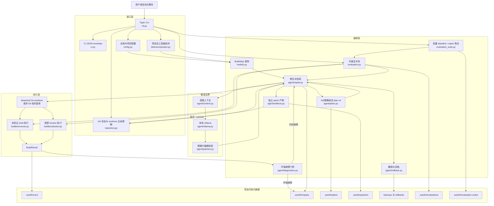

读图时应区分三条边界：配置和检测只决定候选验证计划；模型只能产生候选编辑；最终接受与否只由确定性校验器和真实构建结果决定。Ollama 不直接写项目文件，也不能绕过 `BuildStep` 矩阵。

### 2.1 核心数据流

| 输入 | 中间对象 | 输出 |
| --- | --- | --- |
| `autofix.yml`、CLI 参数、项目标记 | `ProjectInspection`、`AutoFixConfig` | 有序 `BuildStep` |
| 项目路径、Git porcelain v1 | `GitWorkspaceStatus`、`GitChange` | 仓库身份、HEAD、脏工作区策略 |
| 失败的 `BuildResult`、受限源码 | Ollama JSON、`RepairProposal` | 候选 `FileEdit` |
| 原文件、候选编辑 | `ValidatedChange` | 精确 diff 或拒绝原因 |
| 验证后的修改、执行策略 | `RepairPlan` v4 | 可审核、可确定性应用的 JSON |
| 成功 repair 报告、当前文件 | 反向 diff 与 hash 检查 | rollback 备份和回执 |

## 3. 代码目录与职责

```text
src/autofix/
├── cli.py                  # 命令、参数、用户输出和退出码
├── ci.py                   # CI schema v1、状态分类、固定退出码与原子结果写入
├── config.py               # 用户级/项目级 YAML 合并与校验
├── evaluation.py           # 评测契约、隔离 repair 计分与 JSON 报告
├── models.py               # BuildStep、ProjectMatch、ProjectInspection
├── repository.py           # 只读 Git 身份、porcelain 状态与策略
├── detectors/project.py    # 构建系统与 Python 入口检测
├── builders/
│   ├── runner.py           # 无 shell 的本机构建、超时、运行报告
│   └── docker.py           # Docker 命令、隔离副本、资源限制
├── agent/
│   ├── context.py          # 源码选择、截断、失败格式化
│   ├── diagnostics.py      # 明确环境错误分类
│   ├── ollama.py           # 提示词、JSON Schema、HTTP 客户端
│   ├── patches.py          # 行编辑归一化、验证、应用与恢复
│   ├── artifacts.py        # 确定性 unified patch、独占写入与字节摘要
│   ├── repair.py           # 多轮修复状态机、隔离验证、写回、报告
│   ├── plans.py            # 预览 plan、原文件 hash、重新校验
│   ├── rollback.py         # 反向 diff、备份、回执和 undo 选择
│   └── textio.py           # 保留 LF/CRLF 的精确 UTF-8 源码读写
└── runtime/
    ├── doctor.py           # 本机工具和 Ollama 服务诊断
    ├── offline.py          # 离线就绪检查
    ├── bundle.py           # 离线导出、manifest、校验和导入
    └── tools.py            # PATH 与 Windows 标准安装位置发现
```

`tests/` 按上述模块覆盖检测、配置、执行、Git 状态/worktree 生命周期、Docker 参数、模型协议、补丁安全、隔离提交、plan、rollback、离线检查和 bundle。

### 3.1 Git 状态与隔离工作区

`inspect_git_workspace()` 只调用无 shell、带超时的 Git 元数据命令。仓库根目录来自 `git rev-parse --show-toplevel`，分支使用 `symbolic-ref`，HEAD 使用 `rev-parse --verify HEAD`，变更使用 NUL 分隔的 `status --porcelain=v1 -z --untracked-files=all`。NUL 格式避免空格、引号和换行路径造成普通行解析歧义；解析器保留状态码前导空格，并记录 rename/copy 的原路径。

`GitWorkspaceStatus` 明确区分 `git-unavailable`、`not-repository`、`clean` 和 `dirty`。有基线 commit 的干净仓库为 `allowed`，脏仓库为 `blocked-dirty`，尚无 commit 的仓库为 `blocked-unborn`，非 Git 项目为 `unversioned`。CLI 在创建 Ollama 客户端前执行同一策略；核心 API 再次校验，避免其他调用方绕过门禁。

状态模型保留完整 porcelain `changes`，所以 `git-status` 不会伪报 Git clean。repair 的 `blocking_changes` 仅排除当前项目 `.autofix/` 下的 `??` 未跟踪审计产物，避免 run/repair 生成的报告反过来阻塞 apply-plan；tracked `.autofix` 修改和所有其他路径仍然阻断。检测到 `.git` 标记但找不到 Git 可执行文件时明确停止，不降级为 unversioned。

`create_detached_worktree()` 从已记录的 HEAD commit 创建无分支临时 worktree。若用户传入仓库子目录，repair 使用 worktree 中对应的相对子目录。基线构建、上下文读取、模型编辑和验证都发生在 worktree；成功 `--apply` 仍通过原文件 bytes 检查和 `ValidatedChange` 写回，不执行 commit、push 或 merge。正常、验证失败、模型异常和 `KeyboardInterrupt` 都会执行定向 `git worktree remove --force`；清理失败会明确要求检查注册项，但不会自动全局 prune 用户的其他 worktree。

### 3.2 评测层不是另一套修复器

`evaluation.py` 复用 `BuildStep`、`run_build`、`repair_project` 与 Docker runner，不复制 repair 算法。它只增加一个外部验收契约：用例必须在声明的步骤以预期退出码和输出特征稳定失败；模型修复必须通过原命令矩阵；最终变更路径必须落在 `allowed_change_paths` 内；`required_change_paths` 必须全部命中。

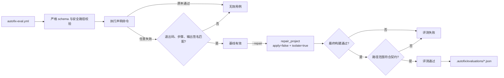

评测命令永远不给 `repair_project` 传 `apply=true`。即使模型得到通过构建的方案，原始 fixture 仍保持故障状态，可重复运行。repair 模式会先独立执行一次 preflight；如果 `expected_failure` 不匹配，则不进入模型边界，proposal 数保持为 0。清单路径会统一为 POSIX 相对路径，并拒绝绝对路径、`..`、项目外解析结果、重复项和不存在的文件。评测报告同时记录清单 SHA-256，便于判断两次分数是否基于同一契约。

### 3.3 独立重试与证据累积

0.19.0 将“候选编辑状态”和“重试证据状态”分离。候选验证失败后，文件恢复到本轮开始前的字节；但 `VerificationFailure` 保留 diagnosis、`ValidatedChange.diff` 和 `BuildResult`。下一轮看到干净的编号源码，同时收到最近三轮累计证据。

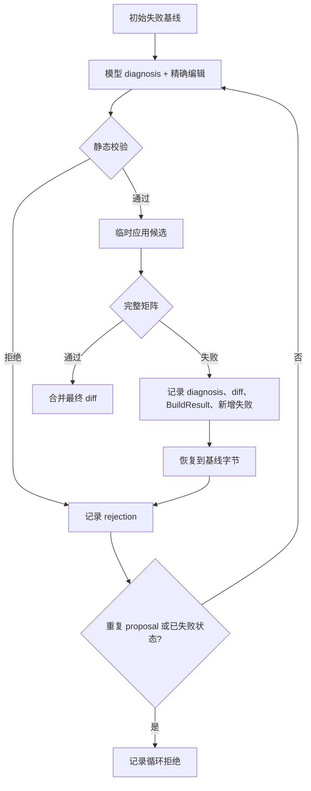

首轮温度为 0，保证可重复；有失败证据的重试使用 0.15，帮助模型离开已证伪的局部答案。随机性不能绕过任何安全边界：JSON Schema、精确旧文本、路径限制、破坏性检查和真实构建仍全部执行。模型协议要求 `diagnosis` 只报告因果文件、编号行和分支事实，不要求也不保存隐藏推理过程。

重复恢复是一个更窄的第三档：若上次候选与更早编辑的 fingerprint 完全相同，反馈加入 `DUPLICATE RECOVERY REQUIREMENT`，指出相同坐标/替换必然再次被拒绝，并将下一次温度设为 0.25。验证失败反馈同时区分 persistent original failures 与 newly failing checks，并要求执行 diagnosis→可达性→实际 diff 的一致性审计。该机制只改变下一次模型输入和采样，不改变候选接受条件，也不会为重复候选重复运行构建。

### 3.1 CI 契约边界

`ci.py` 不实现新的构建器，也不调用模型。`ci-check` 复用项目检测、Git 只读状态、`run_build`/`run_build_docker` 和环境错误分类，再把结果映射到固定 envelope：

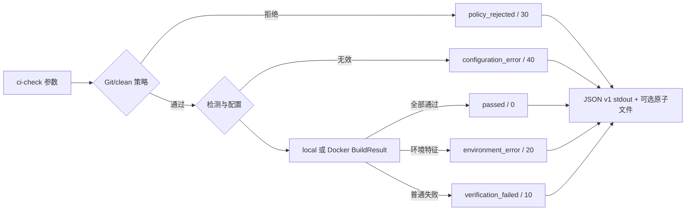

未预期异常映射为 `internal_error / 70`，避免 CI 只能看到不可区分的退出码 1。原始工具退出码仍保存在 `BuildResult`，所以固定契约不会丢失诊断信息。该入口默认不保存 `.autofix/runs`，避免仅为 CI 取证污染 checkout；`--save-run-report` 为显式选择。

### 3.4 批量 baseline 与 repair 评测

`evaluation_suite.py` 是 `evaluation.py` 之上的聚合层，不复制单用例验收逻辑。它先确定性遍历目录并排除版本控制、审计、依赖缓存和构建产物，再逐个调用 `load_evaluation_manifest()` 与 `evaluate_project(save_report=False)`。因此套件与单用例共享完全相同的故障签名、隔离修复和范围判定，同时不会在遍历过程中生成新清单或递归读取自己的报告。

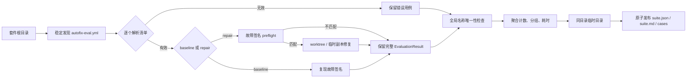

单个用例的解析或执行失败只改变该用例状态，不中断其余用例；重复 `case.name` 会把所有冲突项标记为失败。只有根目录无清单、repair 缺少模型或聚合报告无法发布才属于套件级错误。`autofix-evaluation-suite` v1 固定为 `mode=baseline`；历史 v2 repair schema 记录候选质量，当前 v3 在同一 repair 外层契约上增加上下文检索和成本指标。失败异常携带内存态 `RepairResult`，因此 `--no-save` 不依赖读取临时 repair JSON 也能聚合拒绝和验证失败。

v3 case 的外层字段继续复用 v2，失败摘要仍使用 `error`；完整证据放入开放的 `evaluation.repair_details`。版本提升只因为严格 `metrics` 对象增加了必需字段，避免悄悄破坏 v2 schema。终端通过 `EvaluationSuiteCase.failure_summary` 区分契约不匹配、环境/模型错误、静态拒绝、验证失败和范围失败。JSON 不截断；Markdown 只截断超长展示片段，避免单份编译日志淹没整套报告。

修复状态机通过可选 `RepairProgressCallback` 发出 `initial_verification_*`、`model_waiting`、`proposal_received/rejected`、`verification_started/failed`、`repair_succeeded/exhausted` 等不可变事件；回调只观察已有状态，不参与接受决策。套件将其包装为带用例序号和相对路径的 `EvaluationSuiteProgressEvent`。CLI renderer 在阻塞的模型请求和构建期间维护 Rich spinner，在状态边界停止 spinner 并写入持久终端行。`--json` 不注册 renderer，因此机器输出不会混入日志。

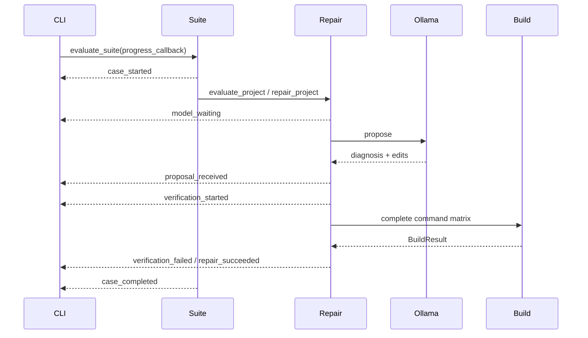

## 4. 配置系统

`config.py` 定义不可变的 `AutoFixConfig`：

```python
@dataclass(frozen=True)
class AutoFixConfig:
    path: Path
    version: int
    command: str | None
    commands: tuple[str, ...]
    build_system: str | None
    docker_image: str | None
    ollama_model: str | None
    offline: bool
    dependencies_bundled: bool
```

`load_config()` 分别读取用户级配置与项目配置，对 `build`、`runtime` 两个 mapping 做字段合并。项目字段覆盖用户字段；CLI 层再用显式参数覆盖合并结果。`build.command` 与 `build.commands` 是互斥字段：项目声明其中一个时，会明确替换用户级配置中的另一种形式，而不是合并成歧义配置。YAML 必须是 mapping，当前只接受版本 1，字符串不得为空，命令矩阵必须是非空字符串列表，布尔字段必须真的是布尔值。

用户路径默认是 `Path.home() / ".autofix" / "settings.yml"`，也可通过 `AUTOFIX_HOME` 改变根目录。项目文件优先查找 `autofix.yml`，其次 `.autofix.yml`。

## 5. 项目检测与命令选择

`detectors/project.py` 为每种构建系统返回 `ProjectMatch`，其中包括语言、构建系统、标记文件和一个或多个 `BuildStep`。检测优先级是：Python、CMake、Maven、Gradle、Node、Rust、Go；`ProjectInspection.selected` 默认使用第一个匹配。

`ProjectInspection.select()` 可以把指定的已检测系统稳定地移动到 matches 首位，其他匹配顺序不变。CLI 按 `--build-system`、项目 `build.system`、默认检测顺序选择，拼写错误或未检测到的系统会列出实际候选并在执行前停止。这样 Docker 默认镜像、自动命令和用户输出都基于同一个选中对象，而不是各模块独立判断。

Python 比简单的“看到 `.py` 就 compileall”多一步运行性分析：

- 有测试标记时选择 pytest；
- 否则用 AST 检查根目录脚本是否存在顶层运行逻辑；
- 优先 `main.py`、`app.py`、`run.py`；
- 只有一个可运行脚本时直接执行它；
- 否则才退回 `compileall`。

这解决了语法检查通过、运行时错误却永远无法进入 repair 的问题。CLI 还会识别旧版本生成的 `python -m compileall -q .` 配置；若现在能够可靠识别入口，会在当前运行中升级为入口命令并打印提示，但不会偷偷重写配置文件。

自定义命令由 `shlex` 解析成 argv。执行器不启用 shell，因此管道、重定向、环境变量展开和命令连接符不会自动解释。这是明确的安全边界；复杂流程应放进项目自身受审查的脚本，再把脚本作为单个命令执行。

### 5.1 有序构建矩阵

`build.commands` 和可重复的 `--step` 最终都转换成 `tuple[BuildStep, ...]`，因此复用检测器原本就支持的多步骤执行模型。优先级是：CLI `--step`、CLI `--command`、项目/用户 `build.commands`、项目/用户 `build.command`、检测结果。`--step` 和 `--command` 同时出现会在启动子进程前被拒绝。

矩阵不是 shell 命令链：每个元素独立解析和执行，前一步成功才进入下一步。报告保留每个已执行步骤的 argv、输出、退出码与耗时；未执行步骤不会伪造结果。repair 每一轮都重新运行同一完整矩阵，只有全部步骤通过才提交。

## 6. 构建执行模型

### 6.1 本地执行

`builders/runner.py` 逐步执行 `BuildStep.argv`，捕获 stdout、stderr、退出码和耗时；失败后停止后续步骤。每一步分别拥有完整的 `timeout_seconds` 上限。默认报告写入 `.autofix/runs/`。

执行器为每次构建分配临时 `PYTHONPYCACHEPREFIX` 和 `GOCACHE`，防止旧 Python bytecode 干扰验证，也避免 Go 在受限 Windows 环境写用户级缓存。若 argv 第一个元素是项目内明确的相对路径（例如 `build/Release/test.exe`），执行前会解析成仍位于项目根目录内的绝对路径，以适配 Windows `CreateProcess`；普通 PATH 命令不改变。

成功判定只依据实际进程退出码。输出中出现 warning 不会被误判为失败。

### 6.2 Docker 执行

`run_build_docker()` 先用 `shutil.copytree()` 创建一次性工作区，再把该副本 bind mount 到 `/workspace`。所以即便构建工具在工作目录写文件，也不会污染原项目。

构造出的容器具有：

```text
docker run --rm --pull never --init
  --read-only
  --cap-drop ALL
  --security-opt no-new-privileges
  --cpus <limit>
  --memory <limit>
  --pids-limit <limit>
  --tmpfs /tmp:rw,noexec,nosuid,size=512m
  --network none                 # 默认
  --mount type=bind,...,/workspace
  --workdir /workspace
```

`HOME`、`XDG_CACHE_HOME` 和 Python bytecode cache 都指向 `/tmp`。镜像名、内存格式和资源范围在生成命令前校验。包含逗号的 Windows 源路径因 Docker mount 语法歧义而被拒绝。

需要注意两个不同层次的隔离：Docker 执行器保护 repair 工作区免受“构建过程写入”；repair 的 detached Git worktree（非 Git 项目为临时副本）保护原项目免受“模型编辑与失败尝试写入”。二者同时启用时，模型在 repair 隔离工作区中修改，构建又在 Docker 的第二层副本中运行。

## 7. 环境故障分类

初始构建失败后，`agent/diagnostics.py` 只扫描真正失败的步骤，检查高置信度环境错误。此前成功步骤输出中的 warning 不参与分类，避免历史日志遮蔽当前代码故障。

| 生态 | 当前高置信度规则 | 建议动作 |
| --- | --- | --- |
| 通用 | 步骤退出 127；脚本内部命令显示 `not found` 或 Windows `not recognized` | 安装工具或更换镜像 |
| Python | `ModuleNotFoundError`；原生 DLL 加载失败 | 安装兼容依赖 |
| Node.js | `Cannot find module/package`，且顶级包已声明在 `package.json` 的依赖字段 | 恢复 lockfile 依赖或镜像中的 `node_modules` |
| CMake/C/C++ | 找不到 C/C++ compiler；找不到 Ninja 等 build program | 安装编译器/生成器 |
| Go | cgo 明确找不到 C compiler | 安装 C 工具链或使用包含它的镜像 |
| Rust | linker 明确不存在；Cargo `--offline` 需要未缓存下载 | 安装 linker，或预取/vendor 依赖 |
| Java | `JAVA_HOME` 缺失/无效；只有 JRE 没有 compiler；目标 release 不受当前 JDK 支持 | 配置匹配版本的 JDK |
| Docker | daemon 无法连接；绑定镜像本地不存在 | 启动 Docker Desktop，或先 build/load/pull 镜像 |

识别后写 repair 报告并抛出 `RepairEnvironmentError`，不会调用模型。这一策略防止模型为了缺少 torch、lodash、gcc 或 JDK 而删除业务逻辑或伪造 fallback。普通 `NameError`、Node 相对模块缺失、Go/Rust 未定义符号、Java `cannot find symbol` 和编译器报告的源码语法错误都不属于环境分类，仍可进行源码修复。

Node 规则额外解析项目根目录 `package.json`，将子路径请求（如 `lodash/fp`）归一为顶级包 `lodash`。只有它出现在 `dependencies`、`devDependencies`、`peerDependencies` 或 `optionalDependencies` 时才认为运行环境没有恢复已声明依赖；未声明包可能是源码拼写错误，因此不提前停止。

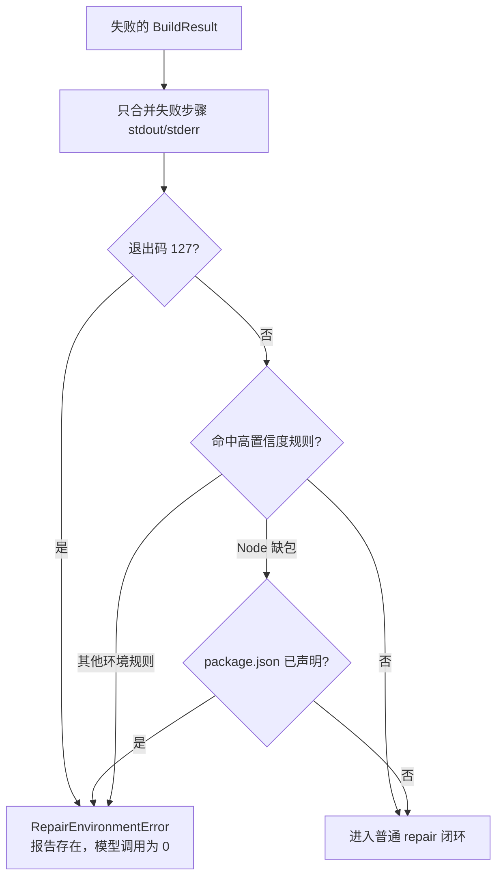

分类有意保守：不能确定是环境问题时交给普通修复闭环，而不是用宽泛正则提前停止。当前文本模式主要覆盖英文工具输出；未来增加本地化模式时必须同时添加代码错误负向样例。

## 8. 上下文选择与隐私边界

`collect_source_context_with_metadata()` 先从构建输出提取直接引用文件，再有界遍历这些文件能够解析到的项目内依赖：Python 的 `import/from`、JavaScript/TypeScript 的相对 `import/require`、C/C++ 的引号 `include`。遍历带 visited 集合并最多检查 `max_files × 4` 个节点，因此能经过 `__init__.py` 重导出找到实现，又不会被循环或巨大依赖图拖住。Python 绝对模块若不在项目根目录，还可以通过唯一的模块后缀映射到常见 `src/` 布局；出现两个候选时放弃映射，不任意选择。排序依次考虑直接引用的生产文件、本地导入的生产文件、直接引用的测试、其余导入与项目回退源码。这样即使堆栈只指向测试，也能在文件预算耗尽前把被测实现交给模型。`collect_source_context()` 保留兼容的字典返回值。

每个实际入选文件都生成 `ContextSelection`：记录项目相对路径、`build-output` / `local-import:<来源>` / `project-source-fallback` 原因、测试属性、发送字符数和是否截断。repair report 按 attempt 保存这些不含源码正文的元数据；套件终端在请求模型前显示前六项。模型提示也收到同一原因列表，但它只用于相关性说明，不授予编辑权限。

repair suite JSON v3 把这些记录聚合为检索质量与成本指标。首轮上下文和清单 `required_change_paths` 计算 required-path recall、Top-5 recall 与平均命中排名；所有尝试累计文件数、字符数、截断与 fallback。v1 baseline、历史 v2 repair schema 保持不变，因此旧报告不会被新字段重新解释。

上下文收集入口会先将项目根路径规范化，再处理目录遍历结果和构建输出中的文件路径。这用于统一 Windows 8.3 短路径（例如 `RUNNER~1`）与长路径所指向的同一目录；随后仍以解析后的候选路径执行根目录包含检查，因此路径别名兼容不会放宽项目边界或允许读取项目外文件。

默认上限：

| 内容 | 上限 |
| --- | ---: |
| 源码文件数 | 30 |
| 单文件字符数 | 16,000 |
| 全部源码字符数 | 60,000 |
| 失败输出 | 最后 24,000 字符 |

忽略 `.git`、`.autofix`、缓存、虚拟环境、构建产物、依赖目录和符号链接。仅收集列入白名单的语言源码后缀与构建配置文件。导入解析只接受最终解析到已枚举项目源码集合的路径，并再次执行规范化根目录包含检查；包管理器依赖、绝对外部 import 和不存在的猜测路径不会进入上下文。

Ollama URL 默认为 `http://127.0.0.1:11434`，数据不需要发往云端。但自定义 `--ollama-url` 可以指向远端服务；这时源码和失败输出会发送到该地址，调用者必须自行评估保密性。

## 9. Ollama 协议

`OllamaClient.propose()` 调用 `/api/chat`，设置：

- `stream: false`；
- `think: false`；
- `temperature: 0`；
- `format` 为动态 JSON Schema；
- system prompt 要求最小修改并只返回合法结构。

模型面对的编辑结构为：

```json
{
  "summary": "修复未导入的 torch",
  "edits": [
    {
      "path": "nnModule.py",
      "start_line": 1,
      "incorrect_code": "",
      "corrected_code": "import torch\nimport torch.nn as nn\n",
      "reason": "文件使用 torch 和 nn，但没有导入"
    }
  ]
}
```

`start_line` 从 1 开始。`incorrect_code` 是指定位置必须存在的精确旧文本；空字符串表示插入。内部 `FileEdit` 会派生 `delete_lines`。响应对象不允许额外字段。

动态 schema 将当前上下文路径作为允许值，并且默认从可编辑路径枚举中排除测试文件。测试仍作为只读上下文显示。`--allow-test-changes` 会显式扩大枚举。

## 10. 补丁验证与最小修改

`patches.py` 不让模型重写未声明范围之外的内容。核心过程为：

1. 将 Windows 分隔符统一为项目相对路径；
2. 拒绝绝对路径、`..` 和解析后逃出根目录的路径；
3. 拒绝不存在的文件、符号链接绕过和不支持类型；
4. 默认拒绝测试路径；
5. 读取现有 UTF-8 文本；
6. 校验起始行、删除范围和 `incorrect_code` 精确一致；
7. 拒绝同一位置插入或范围重叠；
8. 从原始行数组倒序 splice，仅替换声明区间；
9. 对最终文件执行破坏性检查；
10. 生成 `ValidatedChange` 和统一 diff。

边界上限为：最多 20 个行编辑、最多 5 个文件、旧/新编辑文本总计最多 200,000 字符。

小模型偶尔会把“包含大量未变化行的 code block”误标为插入。验证器只在旧文本能精确锚定源码时，把候选块缩减成共同前后缀之间的最小差异；无法唯一匹配则拒绝。换行符缺失也只做可证明的 CRLF/LF 对齐。

对于常见的小模型坐标偏差，验证器允许两种确定性重定位：旧文本在整个文件中按行只有一个精确候选；或单行内容忽略前导缩进后只有一个候选。后一种情况使用源码的真实缩进重建新行。多个候选、内容差异或多行缩进差异仍然拒绝，不进行模糊相似度猜测。

源码通过 `textio.py` 以 `newline=""` 读取和写入。模型文本会先转换到目标文件已有的 LF 或 CRLF 风格；apply 与 rollback 不再触发 Windows 通用换行转换。这个不变量由 LF/CRLF 参数化测试和 apply→undo SHA-256 实测共同覆盖。

默认破坏性保护包括：

- 原文件至少 10 个非空行时，新文件少于其一半则拒绝；
- Python 顶层函数、异步函数或类从 AST 中消失则拒绝。

`--allow-destructive-changes` 会绕过这两项结果级检查，但不会绕过路径、范围、旧文本和大小限制。

旧版 plan/测试仍可使用完整文件替换协议。为了修复曾发生的“模型只返回 `import torch`，导致整个文件只剩一行”，Python 的 import-only 完整替换会被转换为向原文件插入缺失 import，而不是覆盖原内容。这是兼容保护；新模型请求统一使用行级协议。

## 11. Repair 状态机

`repair_project()` 的核心伪代码如下：

```text
git = validate_git_policy(original)
work_root = detached_worktree(HEAD)  # 干净 Git 仓库
            or temporary_copy(original)  # 非 Git 项目

initial = build(work_root)
if initial passes: report and return
if confident_environment_failure(initial): report and stop
current = initial

for attempt in 1..max_attempts:
    context = collect(work_root, current)
    proposal = ollama.propose(context, previous_feedback)
    changes = validate(proposal)
    if rejected:
        remember exact rejection as next-round feedback
        continue
    apply(changes, work_root)
    current = build(work_root)
    if current passes:
        consolidate(original -> final work_root)
        if apply:
            ensure original bytes have not changed concurrently
            write consolidated changes to original
        report and return success
    previous_feedback = current failure

remove detached worktree / discard copy / restore direct-mode backups
report failure
```

### 11.1 一次隔离预览的时序

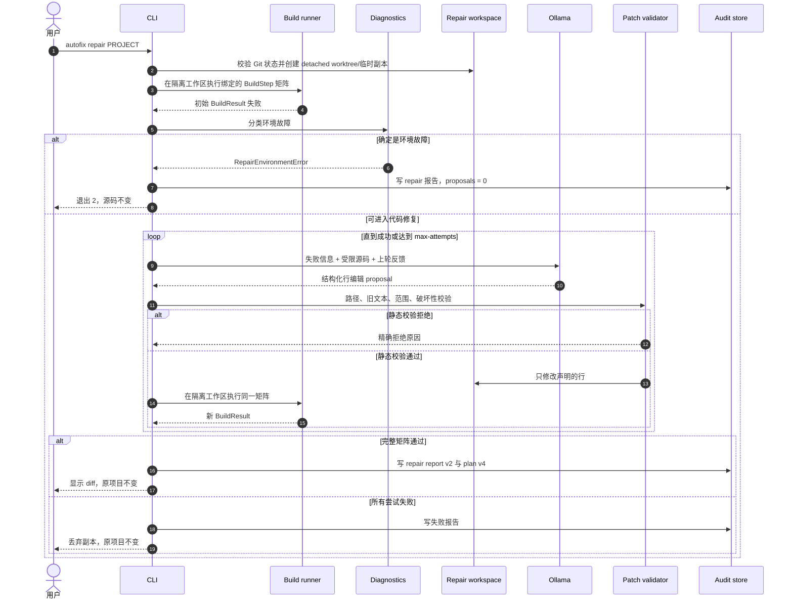

预览路径始终创建隔离工作区，即使没有显式指定 `--isolate`。Git 项目使用当前 HEAD 的 detached worktree，并要求整个仓库干净；非 Git 项目回退临时副本。0.19.0 起，每个候选都从同一个初始故障基线开始；验证失败的候选会先记录 diagnosis、精确 diff、构建结果和新增失败测试，再把工作区恢复到基线。下一轮不会继承错误源码，但会收到最近三轮累计失败证据。

这种“源码状态独立、证据状态累积”的策略防止早期错误修改污染后续方案，也使最终 plan/diff 只包含一个从原文件到验证通过状态的变化。代价是目前不适合必须分多步、且每个中间步骤单独不能通过完整矩阵的迁移任务；这类任务需要未来显式的分阶段计划协议，不能通过隐式叠加失败候选实现。

若提议在静态检查阶段被拒绝，拒绝原因、实际编辑和摘要会作为下一轮反馈，要求模型给出真正不同且最小的生产代码修改。完全重复的 proposal 和回到已验证失败源码状态的循环会被确定性拒绝。

## 12. 预览、应用和并发安全

`using_temporary = isolate or not apply`，因此：

- 默认预览永远使用 detached Git worktree 或非 Git 临时副本；
- 默认 `repair --apply` 因 `--isolate` 也使用上述隔离工作区；
- 只有显式 `--apply --no-isolate` 才直接修改原项目。

隔离成功后，代码逐文件把“原始项目内容”和“隔离工作区最终内容”合并为 `ValidatedChange`。若要应用，会比较修复开始时保存的原始 bytes 与当前目标 bytes；任一文件在期间被编辑，就抛出错误而不是覆盖并发工作。

Git 的 `core.autocrlf` 可能让 detached worktree 使用 CRLF，而调用方当前文件仍保留 LF。合并隔离结果时先以真实目标文件为准统一换行风格，再计算 diff、plan digest、patch 和写回内容；因此同一个已验证方案不会仅因两个 worktree 的检出策略不同而发生摘要漂移。

repair report v2 的 `workspace` 记录 `kind`、`repository_root`、仓库指纹、`baseline_commit` 和项目子路径，顶层 `diff_sha256` 记录规范化最终 diff 摘要。报告中的项目/build root 统一指向真实项目，不泄露或引用已经删除的临时路径。

直接模式会在首次修改前保存 bytes。异常或最终验证失败时默认恢复所有备份；只有显式 `--keep-failed` 才保留失败修改。

## 13. Repair plan 的确定性

预览成功后，`plans.py` 保存格式版本 4：

```json
{
  "format": "autofix-repair-plan",
  "version": 4,
  "created_at": "...",
  "model": "qwen3:0.6b",
  "summary": "...",
  "changes": [
    {
      "path": "calculator.py",
      "original_sha256": "...",
      "content": "验证后的完整最终内容",
      "reason": "..."
    }
  ],
  "verification": {
    "runner": "docker",
    "timeout_seconds": 300.0,
    "steps": [
      {"label": "Compile", "argv": ["python", "-m", "compileall", "-q", "."]},
      {"label": "Test", "argv": ["python", "-m", "pytest"]}
    ],
    "docker": {
      "image": "autofix-python:3.11",
      "cpus": 2.0,
      "memory": "2g",
      "pids_limit": 256,
      "allow_network": false
    }
  },
  "provenance": {
    "kind": "git",
    "repository_fingerprint": "...64 hex...",
    "baseline_commit": "...full Git object id...",
    "project_subpath": "."
  },
  "diff_sha256": "...64 hex..."
}
```

`apply-plan` 不再次调用 Ollama。加载时先校验 provenance，再执行完整的路径、文件类型、测试保护和破坏性校验，比较当前文件 SHA-256 与 `original_sha256`，最后重建规范化 diff 并核对 `diff_sha256`。任何差异都会停止。v4 继承 v3 的 `verification`：保存预览真正通过的无 shell argv、local/Docker runner、每步超时，并在 Docker 模式保存镜像、CPU、内存、PID 与网络策略。显式 CLI 选项只作为一致性断言，不能覆盖绑定值。

仓库指纹优先对 `remote.origin.url` 做 SHA-256；无 origin 时对排序后的 Git 根提交集合做 SHA-256，因此报告和 plan 不保存远端 URL 或本机仓库路径作为身份数据。Git baseline 接受 SHA-1 与 SHA-256 object format 的完整对象 ID。指纹和 diff 摘要用于检测漂移/损坏，不提供签名真实性：能够修改 plan 的主体仍可重算摘要。

读取器保留 v1/v2/v3 兼容路径。v1 没有 `verification`；v2 复用步骤但 runner 和资源仍来自 CLI；v3 绑定完整执行策略但没有 provenance。v4 对 provenance 和 diff 摘要使用严格 schema，同时继承 v3 的 runner、超时和 Docker 类型/范围校验。

### 13.1 plan v4 应用门禁

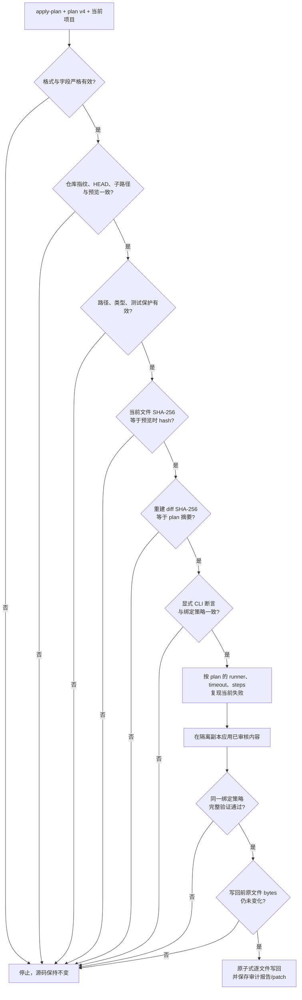

“绑定”与“断言”含义不同：plan 中的值是实际执行值；调用方重复传入 `--step`、`--docker/--local`、`--timeout` 或 Docker 资源选项时，这些参数只用于确认预期，不能覆盖 plan。这样可以阻止预览之后的配置漂移，也避免自动化脚本误把 Docker plan 降级为本机验证。

### 13.2 格式兼容路径

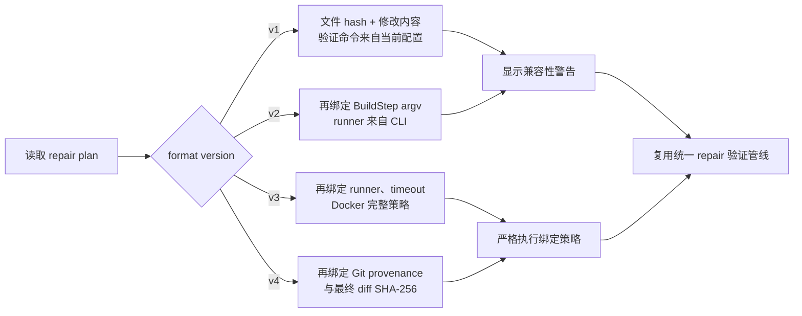

兼容读取不等于旧格式拥有新格式的保证。需要最高确定性时，应重新执行预览生成 v4，而不是手工修改旧 plan 的版本号。

### 13.3 Standalone patch 与显式本地 commit

`artifacts.py` 按项目相对路径排序 `ValidatedChange`，拼接标准 `a/...` → `b/...` unified diff，以 `xb` 独占模式写入新文件，并对文件原始 UTF-8 bytes 计算 SHA-256。默认目录为 `.autofix/patches/`；`--patch-output` 可指定 CI artifact 路径，但拒绝覆盖任何已有文件。该 patch 可在原始 baseline 上使用 `git apply --check` 检查。

本地 commit 是验证成功后的第二个、显式门禁，不属于模型能力。CLI 仅在 `repair --apply --commit` 或 `apply-plan --commit` 时调用 `create_local_repair_commit()`：

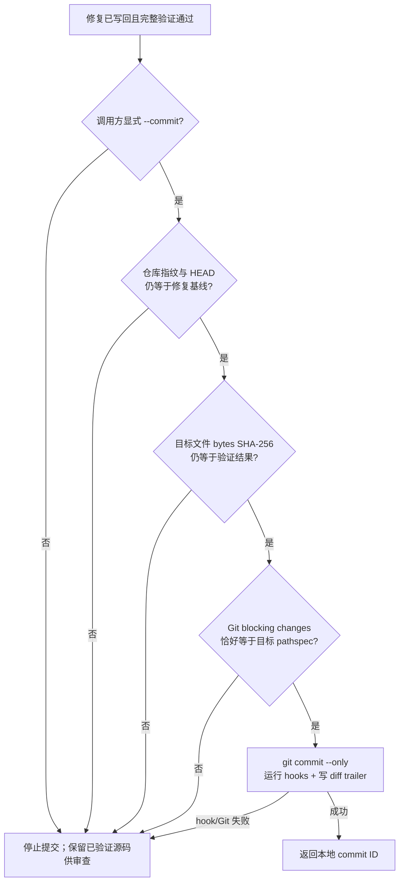

提交命令使用 `--only -- <排序后的精确路径>`，不会把 `.autofix` 报告、patch 或其他文件带入 commit；显式输出到仓库内的新 patch 经摘要核对后可作为已知未跟踪 artifact 排除，但仍留在工作区供上传。commit 保留仓库 hooks，不使用 `--no-verify`，不 amend，也不调用 stash、clean、push 或 merge。提交失败不会伪装为修复失败或删除已经验证通过的源码，而是以退出码 2 要求人工处理。

## 14. 审计与报告

`BuildResult` 包含根目录、所有步骤的 argv、退出码、stdout、stderr、超时状态和耗时。repair 报告额外包含：

- 初始与最终构建；
- 每轮提议摘要；
- 行号、删除行数，以及旧/新文本的 SHA-256（而非在 proposal 区重复全文）；
- 静态拒绝原因；
- 最终 unified diff；
- workspace 类型、仓库指纹、基线 commit、项目子路径与最终 diff SHA-256；
- standalone patch 路径及其原始字节 SHA-256；
- 是否应用、隔离、回滚和成功；
- 顶层错误说明。

报告本身仍可能含构建输出和完整 diff，应按源码和日志的敏感级别管理。

## 15. Rollback 与 undo

`rollback.py` 从成功应用报告的 unified diff 反向重建旧文本。它不是盲目套 patch：解析每个 hunk 时会验证当前新版本行与 diff 中的上下文/新增行完全一致。文件已经被人工修改时停止，避免覆盖后续工作。

写旧内容前，当前文件被复制到带时间戳的 `.autofix/rollback-backups/`；完成后在 `.autofix/rollbacks/` 写 receipt。`latest_rollback_candidate()` 按时间选择最近的成功、已应用、尚未通过 receipt 撤销的 repair，供 `autofix undo` 使用。

当前 rollback 只处理现有文件的文本修改，因为 repair 本身不允许创建或删除文件。

## 16. 离线包设计

`runtime/bundle.py` 创建临时 staging，只有全部步骤成功后才原子改名为目标目录。创建过程：

1. `docker image inspect` 确认镜像存在；
2. 从 `ollama show --modelfile` 解析本地 GGUF，生成引用 `./model.gguf` 的便携 Modelfile；
3. `docker image save` 导出镜像；
4. 复制配置；
5. v2 使用 `pip wheel --no-build-isolation --prefer-binary` 构建 AutoFix 和依赖的 wheelhouse，避免为了临时构建环境再次下载 setuptools；运行依赖仍需已缓存或在联网的制包机上获取；
6. 写 `install.ps1`；
7. 可用时复制仓库文档；
8. 为每个 payload 记录相对路径、大小和 SHA-256；
9. 写 `bundle-manifest.json`。

校验器拒绝 manifest 中的绝对路径、`..`、重复路径、非法 metadata、hash/大小不匹配、缺少必需项，以及存在未列入 manifest 的额外文件。这同时防止路径遍历和离线介质被悄悄添加载荷。

`install.ps1` 先自行验证 manifest，再从 wheelhouse 离线安装 CLI、导入 Docker 镜像、用 Modelfile 创建 Ollama 模型。Python API/CLI 的 `bundle install` 只验证并导入镜像和模型，适合 AutoFix 已安装的机器。

## 17. Windows 工具发现

`runtime/tools.py` 先使用 `shutil.which()`。Windows 上若当前进程 PATH 过旧，还会检查：

- Docker Desktop 的常见 `%LOCALAPPDATA%` 路径；
- `%ProgramFiles%\Docker\Docker\resources\bin\docker.exe`；
- `%LOCALAPPDATA%\Programs\Ollama\ollama.exe`。

这解决“安装后 cmd 能用、未重启的 VS Code 终端不能用”的一部分场景，但不能启动 Docker daemon，也不能替代正确安装。工具路径存在而 daemon 未运行时，Docker 子命令仍会失败并保留原始诊断。

## 18. 安全不变量

维护新功能时不应破坏以下约束：

1. 模型输出永远不直接执行；先解析 schema，再静态验证。
2. 默认只修改现有项目内 UTF-8 白名单文件。
3. 默认不能修改测试。
4. 未声明行保持来自原文件，而不是模型重新生成。
5. 预览绝不写原项目。
6. 默认应用在隔离验证成功后才提交。
7. 文件在预览/修复后发生变化时拒绝覆盖。
8. 失败不产生可应用 plan。
9. 明确环境故障不调用模型。
10. 离线策略默认禁止容器网络，并且不自动拉镜像。
11. 每次应用、失败、拒绝和撤销都留下审计材料。
12. 所有用户提供的项目代码和构建命令都应视为不可信输入。

Docker 限制降低风险，但不是强对抗安全沙箱：容器仍使用宿主 Docker daemon，项目构建也可能利用语言工具链漏洞。高风险代码应在独立虚拟机中运行。

## 19. 测试策略

当前自动测试主要使用临时目录和 fake model/runtime，确保结果可重复。关键测试类别包括：

- 各项目检测器及 Python 入口选择；
- 用户/项目配置合并和非法 YAML；
- 无 shell 构建、超时、报告；
- Docker argv、安全开关和副本隔离；
- Ollama schema 与非法响应；
- 路径遍历、测试文件、重叠编辑、旧文本失配、过大/破坏性修改；
- import-only 防覆盖回归；
- 多轮 repair、预览不写入、隔离应用、并发编辑拒绝；
- plan hash 与 apply-plan；
- rollback 精确匹配、备份和重复 undo；
- Python、Node、CMake/C++、Go、Rust、Java 和 Docker 环境错误不调用模型，同时用负向样例防止源码错误误报；
- 离线检查、bundle hash、路径遍历和安装顺序。

提交前执行：

```powershell
python -m pytest
python -m compileall -q src tests
autofix run . --docker
```

涉及真实集成时还应在临时项目验证：失败可复现、预览不改变文件、plan 可应用、构建通过、undo 可恢复。不要只以 mocked 单元测试代替闭环测试。

## 20. 扩展方式

### 新增构建系统

1. 在 `detectors/project.py` 新增返回 `ProjectMatch` 的检测函数；
2. 将其放入明确的优先级；
3. 在 `builders/docker.py` 的 `DEFAULT_IMAGES` 增加默认镜像（若合适）；
4. 在 `context.py` 扩展源码后缀或配置名；
5. 添加检测、命令和 Docker 测试；
6. 文档明确默认命令与依赖要求。

### 新增环境诊断

只添加高置信度、具有明确用户行动的模式。诊断字符串应说明为什么没调用模型以及如何修复环境，并测试“模型客户端调用次数为零”。不要把普通编译错误宽泛归类为环境问题。

### 新增模型后端

实现 `RepairClient.propose()` 协议即可复用 repair 状态机。新后端必须返回 `RepairProposal`，不能绕过 `validate_changes()`。若后端是远端服务，CLI 和文档必须清晰提示源码外发边界。

### 支持创建/删除文件

这不是在现有 `FileEdit` 上简单放宽检查即可完成。必须同步设计：显式操作类型、目录白名单、冲突检测、plan hash 语义、隔离提交的原子性、rollback 的文件存在性规则和测试。未完整覆盖前应继续拒绝。

### 英文注释与 docstring 规范

源码注释统一使用英文，面向使用者的 Markdown 保持中文为主。维护时遵循：

1. 每个 Python 模块用一句 module docstring 说明职责；
2. 公共类、函数、方法和属性必须说明契约或返回语义；
3. 私有辅助函数仅在算法、安全边界或平台兼容性不直观时增加 docstring；
4. 行内注释解释“为什么存在这个约束”，不复述下一行代码；
5. 安全注释必须与测试对应，不能仅靠文档宣称保护有效；
6. 修改控制流后检查注释所在分支仍可达，避免文档与实际行为漂移。

0.16.0 使用 AST 覆盖审计确认 `src/autofix` 的所有模块和公共符号均有 docstring。此次审计也发现 Python 顶层定义保护被误放在换行归一化函数的提前 `return` 之后；现已移回 `_validate_preservation()` 并用专门回归测试锁定。

## 21. 已知限制与下一阶段

- 多语言仓库可选择一个检测结果，但单次调用尚不能编排多个构建系统；
- 支持有序命令矩阵，但尚不支持条件分支、并行步骤或每步独立环境/超时；
- 只修改现有 UTF-8 文本文件，不创建、重命名或删除；
- 上下文按规则截断，不具备语义索引；
- 环境分类已覆盖主要语言工具链的第一批英文高置信度模式，但尚未全面覆盖本地化输出、SDK/系统头文件和所有依赖解析器；
- 小模型可能反复给出安全但无效或被拒绝的提议；
- 构建通过只能证明配置的门禁通过；若项目重视格式，还应把 formatter/linter 纳入 `build.commands`；
- Docker 镜像必须提前包含全部离线依赖；
- Git worktree 只包含 HEAD 已跟踪内容，不携带被忽略的依赖/生成状态；非 Git 临时副本还会排除缓存、构建目录、依赖目录和符号链接；
- rollback 依赖当前内容精确匹配已应用 diff；
- Windows 离线 bootstrap 当前锁定 Python 3.11 wheelhouse。

下一阶段定义为“真实仓库安全接入与规模化评测”。优先级按风险依赖排序，而不是按功能数量排序：

1. **Git 溯源绑定（已完成当前切片）**：基线 commit、仓库身份、项目子路径和最终 diff digest 已绑定到 plan；成功结果输出可审查 patch，并仅在显式请求时创建本地 commit，不自动 push 或 merge。
2. **CI 契约（下一切片）**：稳定退出码和 JSON schema，提供无交互模式与 GitHub Actions 示例，但默认只产出候选结果，不自动合并。
3. **规模化评测**：实现聚合 runner/scoreboard；扩展 Go、Rust、Java、C++ 与高级 Python/Node 用例；按模型、工具链、runner 和契约 hash 分组。
4. **安全加固**：命令策略、非 root 容器、资源和超时上限、敏感信息脱敏及生成物审计。
5. **语义上下文**：在前述评测可量化后，再引入 AST、符号/依赖图和测试到源码的相关性排序。
6. **发布加固**：许可证、CI、可复现 wheel、签名、版本标签和离线分发验证。

跨系统并行构建、项目镜像生成、文件创建/删除和远端模型后端均保留为后续能力；它们不能排在 Git 隔离、评测和安全策略之前。详细里程碑、完成标准和版本准备清单见[开发路线图](ROADMAP_ZH.md)。

所有优化都应保持一个判断标准：模型可以更聪明，但写入项目的条件必须继续是可审计、可验证、可撤销。

