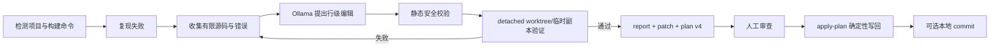

# AutoFix 学习导读

本文面向暂时不准备逐行阅读全部源码的维护者。目标不是一次记住所有实现，而是先建立正确的系统模型，再逐层进入代码。

## 1. 先记住一句话

AutoFix 把“不确定的模型建议”放进“确定的工程门禁”中：模型只能提出候选修改，路径校验、Git 隔离、真实构建、hash 和人工应用流程决定候选能否进入项目。

## 2. 一次修复的主线

理解这十个节点，比先读完所有源码更重要。

## 3. 六个必须掌握的概念

### 3.1 BuildStep

构建命令不是 shell 字符串链，而是有序 argv。AutoFix 按顺序执行，第一步失败后停止，只有所有步骤退出码为 0 才接受修复。

### 3.2 RepairProposal 与 ValidatedChange

`RepairProposal` 是模型的建议，仍然不可信；`ValidatedChange` 是经过路径、旧文本、行号、文件类型、测试保护和破坏性检查后得到的完整修改。只有后者可以进入验证和写回。

### 3.3 隔离工作区

干净且已有 commit 的 Git 项目使用 detached worktree；非 Git 项目使用临时副本。失败候选不会直接污染原项目。

### 3.4 验证门禁

模型不能声称“已经修好”。AutoFix 重新运行真实测试或构建命令，以进程退出码决定候选是否通过。

### 3.5 plan v4

plan 保存已经验证的最终内容，并绑定原文件 hash、验证命令、runner、超时、Docker 策略、仓库指纹、HEAD、项目子路径和最终 diff hash。`apply-plan` 不会再次请求模型。

### 3.6 patch、report 与 commit

report 用于审计过程；patch 用于独立审查和传输；commit 只有显式 `--commit` 时才创建，并且只允许包含验证过的 tracked 文件。三者用途不同，不能互相替代。

## 4. 推荐阅读顺序

1. 阅读本文并完成[动手实验](HANDS_ON_ZH.md)的实验 1～3；
2. 阅读[核心代码导读](CORE_CODE_WALKTHROUGH_ZH.md)中的 CLI、runner 和 repair；
3. 对照[架构文档](ARCHITECTURE_ZH.md)理解安全边界；
4. 阅读 `tests/test_git_worktree.py` 和 `tests/test_plans.py`，从测试反推约束；
5. 最后再阅读 Ollama prompt、环境分类和多语言检测。

## 5. 建议的七次学习任务

| 次数 | 内容 | 完成标志 |
| --- | --- | --- |
| 1 | `inspect`、`run`、BuildStep | 能解释命令如何被发现和执行 |
| 2 | `repair` 主流程 | 能画出失败→提议→验证→结果流程 |
| 3 | `patches.py` | 能解释为什么模型不能直接覆盖文件 |
| 4 | Git worktree | 能解释脏工作区为何提前停止 |
| 5 | plan v4 | 能解释 preview 后为何不再次调用模型 |
| 6 | patch/commit/rollback | 能区分审计、应用、提交和撤销 |
| 7 | 修改一个小功能 | 能增加一个选项、测试并更新文档 |

每次只需完成一个主题。不要以“是否读完所有代码”判断进度，而要以“能否解释输入、输出和失败条件”判断。

## 6. 自测问题

- 为什么测试通过仍不能证明业务完全正确？
- 为什么模型输出先变成 `ValidatedChange`，而不是直接写文件？
- preview 和 `apply-plan` 之间哪些状态变化会导致拒绝？
- 为什么 Git 项目必须有干净的 committed baseline？
- report、plan、patch 的内容和用途分别是什么？
- commit 失败后为什么保留已经验证的工作区修改？

能够用自己的话回答这些问题，就已经掌握了项目最重要的部分。

## 7. 遇到问题时如何定位

1. 先判断失败属于检测、环境、模型提议、静态校验、验证还是写回；
2. 查看终端错误和对应 `.autofix` JSON 报告；
3. 在[核心代码导读](CORE_CODE_WALKTHROUGH_ZH.md)中找到责任模块；
4. 先添加能够稳定复现的测试，再修改实现；
5. 运行相关测试、全量测试、`compileall` 和 `git diff --check`。

这也是后续维护 AutoFix 时应遵循的基本工作方式。
